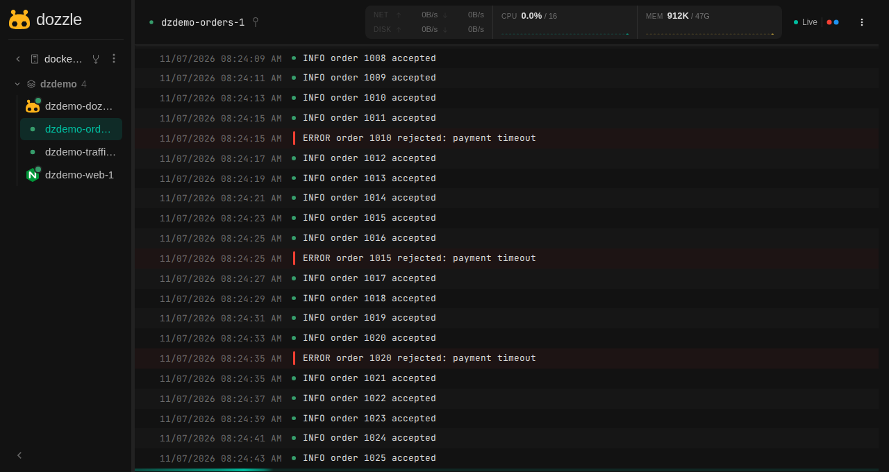

<TLDR>
Following several containers with `docker logs -f` means several terminals and a lot of scrolling. Dozzle is a small web interface that streams the logs of all your containers live, with full-text search and no database. A single service in your `compose.yaml` is enough, and it's the ideal second screen while you develop.
</TLDR>

Your app returns a 500. Was that the API? The worker? The database? So you open a terminal, `docker ps`, copy a name, `docker logs -f`, and then a second terminal, and a third one. While you're arranging windows, the error has long since scrolled out of view.

By the end of this article, you'll have every container's logs in one browser tab, updating live.

<!-- truncate -->

## Seeing It in Action with Docker

Here is Dozzle watching a small demo stack. Select a container on the left and its logs stream on the right; lines written to the error output stand out at a glance:

<BrowserWindow url="http://localhost:8080">



</BrowserWindow>

To get exactly this, save this `compose.yaml` in an empty folder. It starts Dozzle, an Nginx server, a fake order service that regularly fails, and a little traffic so that Nginx has something to say:

<Snippet filename="compose.yaml" source="./files/compose.yaml" defaultOpen={false} />

<Terminal>
$ docker compose up -d
</Terminal>

Open [http://localhost:8080](http://localhost:8080), and click on the `orders` container. You're looking at it live. Now try these:

- Search for `rejected` (<kbd>Ctrl</kbd>+<kbd>F</kbd> in the log view), and only the failing orders remain.
- Click on `web`, and watch Nginx receive a request every three seconds.
- In a terminal, run `docker compose restart orders`, and see the container's state change without any refresh.

When you're done, `docker compose down` removes everything, and nothing remains, since Dozzle stores no logs.

## Why It Stays So Light

- Dozzle doesn't collect or store anything: it reads the logs Docker already keeps and streams them to your browser.
- There's no database, agent or configuration to start with, so the service costs almost nothing to leave running.
- That's also its limit. When Docker rotates or removes a log, it's gone. For history, alerts and long-term search, you need a real log platform.

## Add It to Your Own Project

The only part you need is this service. Paste it into your existing `compose.yaml`:

```yaml title="compose.yaml"
services:
  dozzle:
    image: amir20/dozzle:v11.4.1
    ports:
      - "127.0.0.1:8080:8080"
    volumes:
      - /var/run/docker.sock:/var/run/docker.sock:ro
```

It shows every container on your machine, not only those of this project, so one instance is enough. Prefer a single command that isn't tied to a project? This does the same:

<Terminal wrap={true}>
$ docker run -d --name dozzle --restart unless-stopped -p 127.0.0.1:8080:8080 -v /var/run/docker.sock:/var/run/docker.sock:ro amir20/dozzle:v11.4.1
</Terminal>

<AlertBox variant="warning" title="Keep it private">
Logs regularly contain tokens, e-mail addresses and internal URLs, and the Docker socket gives this container significant power, even with `:ro`. The `127.0.0.1` above makes Dozzle reachable from your machine only. Don't expose it on a server without enabling its [authentication](https://dozzle.dev/guide/authentication) behind HTTPS.
</AlertBox>

## When It Really Helps

- **While you code.** Keep the tab on a second screen. Save a file, and see immediately what your container thinks of it.
- **When a stack won't start.** A service keeps restarting while its <Link to="/blog/docker-health-condition">health condition</Link> never turns green: its error is right there, a click away from those of its neighbors.
- **For a teammate who doesn't like the terminal.** Send them the tab rather than a list of `docker logs` options.

## Dozzle or Something Else?

The right question is what you want to see:

| You want | Use |
| --- | --- |
| One container, quickly, in a terminal | `docker logs -f my-container` |
| Live logs of everything, in a browser | Dozzle |
| To manage containers, images and volumes as well | A full dashboard such as Portainer, or lazydocker in the terminal |
| Logs kept for weeks, with alerts | A dedicated log platform |

Dozzle does one thing, and that's precisely why I'd keep it running. If you manage several Docker hosts, its [agent mode](https://dozzle.dev/guide/agent) brings them together in the same interface.

## Conclusion

At the beginning of this article, a simple 500 error meant three terminals and a race against the scrollback. Now, it's one tab, one click and a search box. Add the five lines of YAML to the project you're working on today and leave the tab open on your second screen. The next time something breaks, you'll probably see it before you even start looking. And if your stack is getting bigger, <Link to="/blog/docker-compose-viz">drawing your Compose services</Link> is a nice way to see what talks to what.
