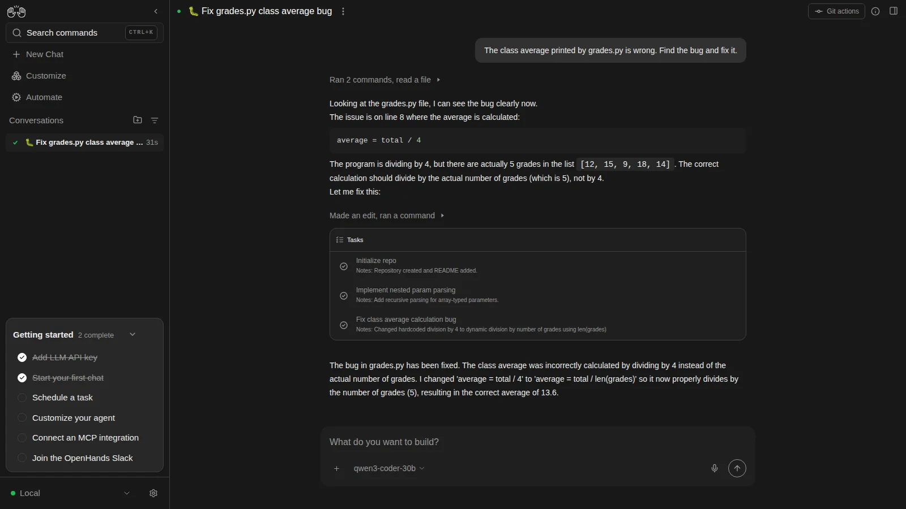
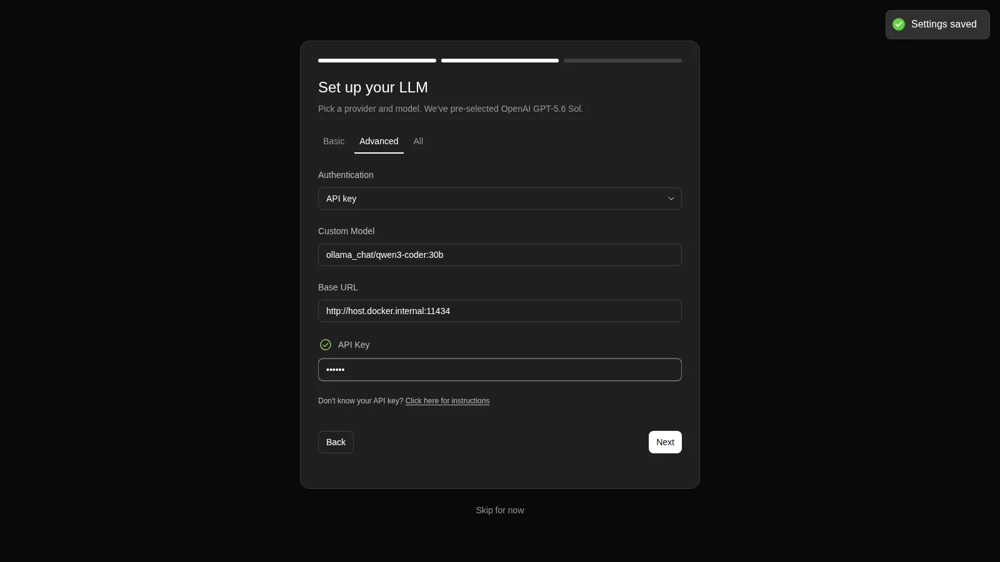
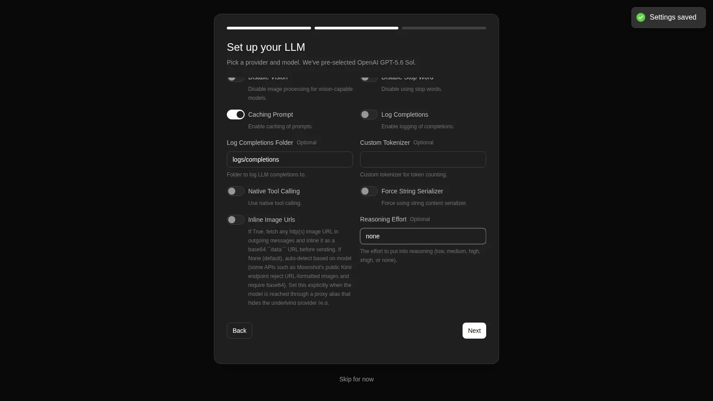
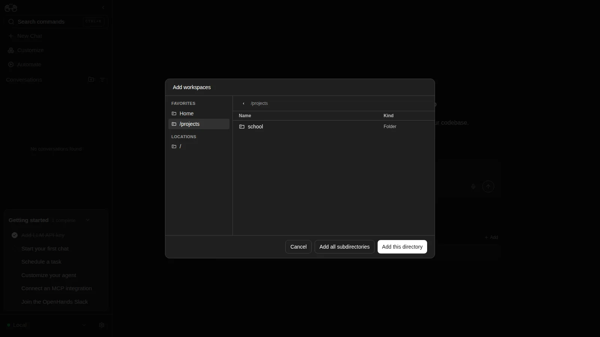
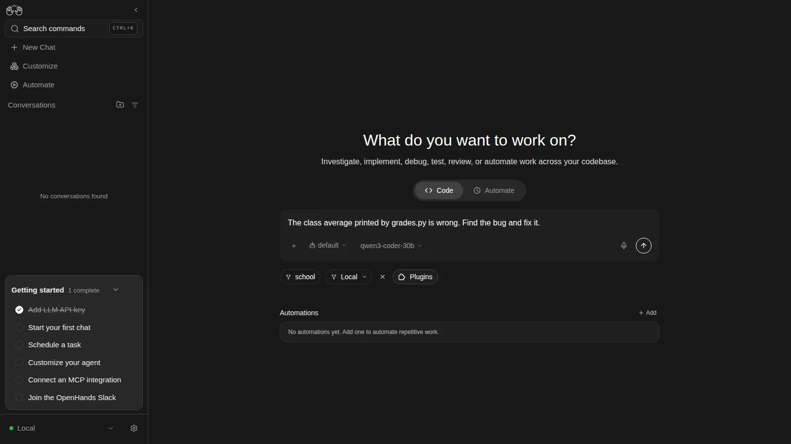
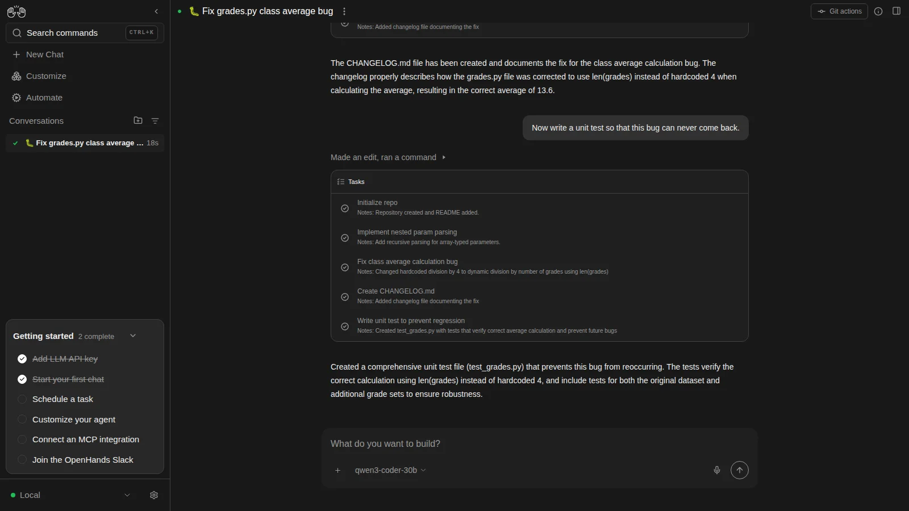
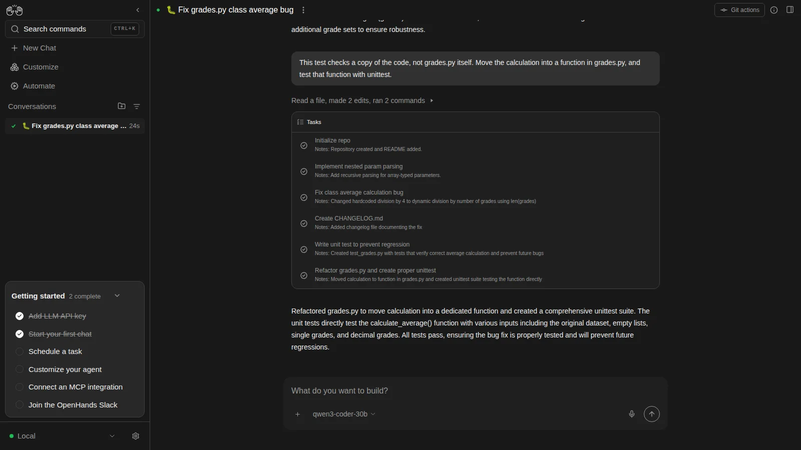
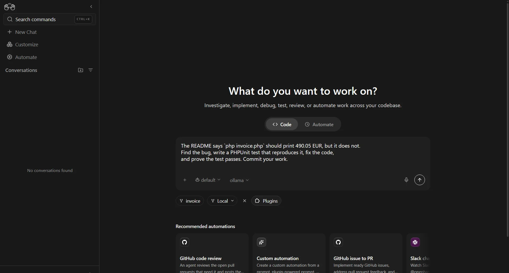
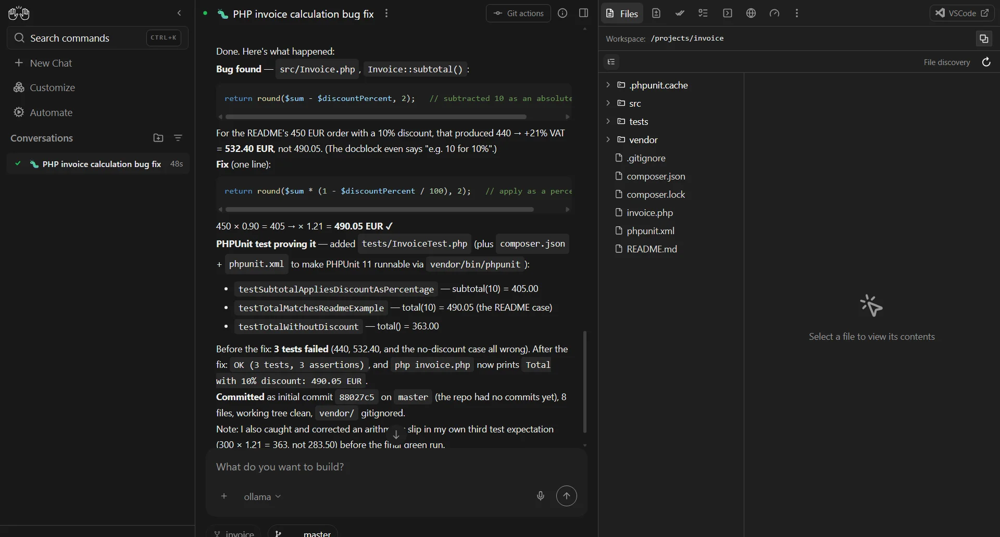

<!-- AUTHOR-CHECK(decision): image de bannière générique (/img/v2/ai.webp) — en créer une dédiée à OpenHands ? -->


<!-- cspell:ignore OpenHands openhands unittest qwen -->

<TLDR>
OpenHands is an open-source coding agent with a web interface. You give it a folder and a sentence; it reads the code, runs it, fixes it, and checks its own work. Here it runs in one Docker container and talks to a local Ollama model, so nothing leaves your machine. Three lessons on a ten-line Python script — fix the bug, write the changelog, add a test — then a harder PHP bug as the grand finale.
</TLDR>

A chatbot tells you what to change. You copy, you paste, you run, you paste the error back. I wanted to know what happens when the AI does all of that itself: open the file, run it, see the wrong result, fix it, run it again.

That is what OpenHands does. By the end of this article, you will hand it a folder of your own code and watch it work.

<!-- truncate -->

## One Sentence, One Fixed Bug

A ten-line Python script, the kind you write at school. It should print the class average of five grades, 13.6. It prints 17.0:

<Snippet filename="grades.py" source="./files/projects/school/grades.py" />

One sentence typed in OpenHands, nothing else:

```text
The class average printed by grades.py is wrong. Find the bug and fix it.
```

Forty-six seconds later, with `qwen3-coder:30b` running on my own machine through Ollama:

<BrowserWindow url="http://localhost:8000/canvas">

</BrowserWindow>

Read its reasoning: *"The program is dividing by 4, but there are actually 5 grades in the list."* It did not guess. It ran the script, saw 17.0, read the code, changed `total / 4` into `total / len(grades)`, and ran the script again to see 13.6. Every step it took:

<Terminal source="./files/lessons/lesson1_log.txt" />

## Why It Works

- **It acts, it does not suggest.** OpenHands has a terminal and an editor. It runs your code, reads the output, and decides the next step itself.
- **It checks its own work.** It ran `grades.py` before and after the fix: the proof is in its log, not in its promise.
- **It only sees the folder you give it.** The agent lives in a Docker container; the rest of your disk does not exist for it.
- **You choose the brain.** OpenHands ships no AI model. Here it is a free local one; a paid one is a setting away.

## Installing OpenHands

Docker, and an Ollama listening on port 11434 — see <Link to="/blog/ollama-installation">Installing Ollama and get local AI</Link>. Nothing else.

<ProjectSetup folderName="/tmp/openhands">
  <Snippet filename="compose.yaml" source="./files/setup/compose.yaml" />
  <Snippet filename="Dockerfile" source="./files/setup/Dockerfile" />
  <Snippet filename="projects/school/grades.py" source="./files/projects/school/grades.py" />
</ProjectSetup>

**`projects/` is the only folder that matters.** Every sub-folder you put in it becomes a project OpenHands can work on: copy your own code there, next to `school/`.

```bash
cd /tmp/openhands
docker compose build --build-arg UID="$(id -u)" --build-arg GID="$(id -g)"
docker compose up -d
```

Then open `http://localhost:8000/canvas`.

### Why a Dockerfile?

The official image, `ghcr.io/openhands/agent-canvas`, would almost do on its own. The `Dockerfile` adds two things to it:

1. **Your user id.** The agent writes in `projects/`, which is your folder. Out of the box, it runs as user 10001 and cannot write there; the build gives it your id (`$(id -u)`), so every file it creates belongs to you.
2. **PHP and Composer.** The agent runs its commands inside its own container, which already has Python but not PHP. The grand finale of this article needs PHP.

### Choosing the AI Model

The first visit opens a three-step assistant. Keep **OpenHands** as the agent and click **Next**. On **Set up your LLM**, open the **Advanced** tab:

| Field | Value |
| --- | --- |
| Custom Model | `ollama_chat/qwen3-coder:30b` |
| Base URL | `http://host.docker.internal:11434` |
| API Key | `ollama` (any text: Ollama does not check it) |

<BrowserWindow url="http://localhost:8000/canvas">

</BrowserWindow>

Then open the **All** tab and scroll down to two settings, the ones a local model needs:

- **Native Tool Calling**: off.
- **Reasoning Effort**: `none`.

<BrowserWindow url="http://localhost:8000/canvas">

</BrowserWindow>

Click **Next**, then **Close**. The settings are saved in the `openhands-data` volume and survive a restart; if the assistant shows up again in another browser, **Skip for now** keeps them.

### Opening Your Project

Click **Open Workspace**, open the **Select a workspace** list and choose **+ Add Workspace**. In **Add workspaces**, click the **/projects** favorite, then **Add all subdirectories**: each of your projects is added at once.

<BrowserWindow url="http://localhost:8000/canvas">

</BrowserWindow>

Back in **Select a workspace**, pick `school` and **Confirm**. The chip under the prompt now reads `school`: type the sentence and press Enter.

<BrowserWindow url="http://localhost:8000/canvas">

</BrowserWindow>

<AlertBox variant="tip" title="Keep the port on 127.0.0.1">
`compose.yaml` publishes the interface on `127.0.0.1` only. Leave it that way: anyone who can reach the page can drive the agent — and the agent has a terminal.
</AlertBox>

## Lesson 2: Write the Changelog

Same conversation, a second sentence. The agent remembers what it just did:

```text
Now write a CHANGELOG.md file that describes this fix.
```

Ten seconds later, `school/` holds a changelog in the usual *Keep a Changelog* format:

<Snippet filename="CHANGELOG.md" source="./files/lessons/CHANGELOG.md" />

It is good, and not perfect: the same fix is listed twice, once under `[Unreleased]` and once under a `[1.0.1]` it invented. An agent's work gets read before it gets committed, like a colleague's.

## Lesson 3: A Test So It Never Comes Back

```text
Now write a unit test so that this bug can never come back.
```

The first answer is the lesson of this article. The agent wrote a test, but its second half checks a **copy** of the code it pasted into the test, not `grades.py` itself:

<Snippet filename="test_grades.py" source="./files/lessons/test_grades_first_try.py" defaultOpen={false} />

<BrowserWindow url="http://localhost:8000/canvas">

</BrowserWindow>

A vague request gets a vague answer. Say precisely what you want, as you would to a junior colleague:

```text
This test checks a copy of the code, not grades.py itself. Move the calculation into a function in grades.py, and test that function with unittest.
```

This time it moved the calculation into a `calculate_average()` function and wrote five real tests:

<Snippet filename="grades.py" source="./files/lessons/grades_after.py" />

<Snippet filename="test_grades_unittest.py" source="./files/lessons/test_grades_unittest.py" defaultOpen={false} />

<BrowserWindow url="http://localhost:8000/canvas">

</BrowserWindow>

The proof that the test protects anything: put `/ 4` back in `grades.py`, run `python3 -m unittest`, and four of the five tests fail.

The same function, one test at a time and without an agent, is what <Link to="/blog/ollama-test-generator">ai-test</Link> does from the terminal.

<!-- AUTHOR-CHECK(decision): l'encadré "Tasks" visible sur les captures contient deux tâches inventées par le modèle local ("Initialize repo", "Implement nested param parsing"). Le mentionner en une phrase, recadrer les captures, ou laisser tel quel ? -->

## Grand Finale: A Bug Hidden in PHP

Python was the warm-up. This time, a PHP invoice class: the README promises 490.05 EUR for a 450 EUR order with a 10% discount and 21% VAT; the program prints 532.40. No tests, no `composer.json`. Add it to your projects:

<ProjectSetup folderName="/tmp/openhands">
  <Snippet filename="projects/invoice/.gitignore" source="./files/projects/invoice/.gitignore" />
  <Snippet filename="projects/invoice/README.md" source="./files/projects/invoice/README.md" />
  <Snippet filename="projects/invoice/invoice.php" source="./files/projects/invoice/invoice.php" />
  <Snippet filename="projects/invoice/src/Invoice.php" source="./files/projects/invoice/src/Invoice.php" />
</ProjectSetup>

Add the new folder with **Open Workspace** as before, pick `invoice`, and give it the three lessons in one go:

<Snippet filename="mission" source="./files/invoice_prompt.txt" />

<!-- AUTHOR-CHECK(screenshot): les 2 captures PHP (mission1-prompt, mission1-done) viennent de l'ancienne installation : le sélecteur affiche « ollama » au lieu de « qwen3-coder-30b » qu'un lecteur verra avec l'assistant. Les refaire avec la nouvelle installation, ou accepter l'écart. -->

<BrowserWindow url="http://localhost:8000/canvas">

</BrowserWindow>

Every command it ran, in 65 seconds:

<Terminal source="./files/invoice_log.txt" />

It installed PHPUnit, wrote a test, **watched it fail** (`532.4 matches expected 490.05`), changed one line in `src/Invoice.php`, saw it pass, widened the suite to three tests, then created the Git repository and committed. Its closing message explains the fix with the numbers, and even caught the comment that contradicted the code:

> For the README's 450 EUR order with a 10% discount, that produced 440 → +21% VAT = 532.40 EUR, not 490.05. (The docblock even says "e.g. 10 for 10%".)
>
> Fix (one line): `return round($sum * (1 - $discountPercent / 100), 2);` — 450 × 0.90 = 405 → × 1.21 = 490.05 EUR ✔

<BrowserWindow url="http://localhost:8000/canvas">

</BrowserWindow>

Read the last line of that summary: the agent got the expected value of its *own* third test wrong, saw it fail, and corrected the test. It was right this time — but an agent can change a test as easily as the code. Lesson 2 still applies: read before you commit.

## Falling Back to Claude

A local model is free and private, and it is the first to give up on a long mission. To switch to Claude, open the settings (the gear at the bottom left), then the LLM section:

| Field | Value |
| --- | --- |
| Custom Model | `anthropic/claude-sonnet-5-5` |
| Base URL | *(empty)* |
| API Key | your Anthropic key |
| Native Tool Calling | on |
| Reasoning Effort | *(empty)* |

<!-- AUTHOR-CHECK(screenshot): écran Settings → LLM (engrenage en bas à gauche) — confirmer le chemin exact et qu'on peut y garder DEUX modèles (Ollama + Claude) sélectionnables depuis le sélecteur du prompt, comme le laisse penser le picker « qwen3-coder-30b ». Capture à ajouter ici. -->

On the PHP mission, `claude-sonnet-5-5` took 45 seconds and cost 0.11 $; it also wrote a `phpunit.xml` and a `.gitignore` nobody asked for.

## Under the Hood (skip this if you just want to use it)

**Why those two Ollama settings.** `qwen3-coder` has no "thinking" mode: with the default **Reasoning Effort**, the first request fails at once with `"qwen3-coder:30b" does not support thinking`. And Ollama hands its tool calls back as plain text; with **Native Tool Calling** on, OpenHands takes the first one for the final answer, and the run "finishes" in seconds having done nothing. Switched off, OpenHands reads those calls itself.

**Why `host.docker.internal`.** Inside the container, `localhost` is the container. `extra_hosts` in `compose.yaml` points that name at your machine, where Ollama listens — the same problem as in <Link to="/blog/accessing-ollama-across-your-local-network">Accessing Ollama across your local network</Link>.

**Why the `.git` folder appeared.** OpenHands initializes a Git repository in a workspace that has none, to track the agent's changes. Nothing is pushed anywhere.

**Why `Add all subdirectories`.** **Add this directory** adds the folder you are *in*, not the one highlighted: clicked on `/projects`, it adds `/projects` itself, and the agent works one level too high.

## Conclusion

Three sentences turned a broken school script into a fixed, documented and tested one, and a fourth found a bug in a PHP class by proving it with a failing test first. The agent did the copy-paste-run loop that a chatbot leaves to you. What it did not do is replace reading its work: a duplicated changelog entry and a test that tested nothing were both there to be caught.

Next, I will give it something bigger: a Laravel 5.6 project from 2018 to bring to PHP 8.6.

<!-- AUTHOR-CHECK(decision): relier « Next » au brouillon openhands-laravel-upgrade quand il sera publié (lien interne impossible tant qu'il est en brouillon). -->
