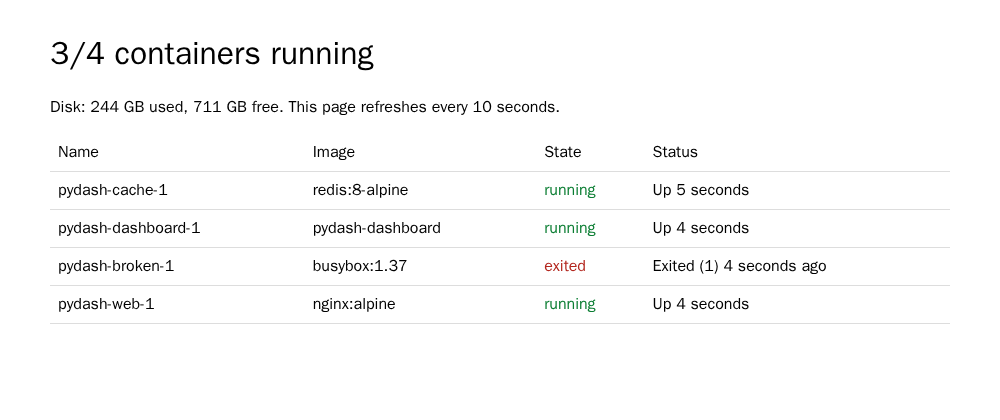

<TLDR>
Python's standard library includes a web server. `python -m http.server` serves a folder in one line, and about a hundred lines of Python using the same module can generate a live dashboard of your Docker containers. There's no framework or `pip install`, and everything here runs in Docker. It's perfect for local tools, though it isn't meant for production.
</TLDR>

You want to look at a generated HTML report, or quickly pass a file to the computer next to you. Should you configure Nginx for that? Start a project with a framework? Like you know me, I like simple things, and the simple solution has been sitting in Python all along.

By the end of this article, you'll serve any folder in one line, and you'll have written a small dashboard showing which of your containers are running, or not.

<!-- truncate -->

## Seeing It in Action with Docker

*Just need the one-liner? [Jump to it](#serve-any-folder-in-one-line) — this chapter builds the whole demo.*

Here's where we're going: one Python file, using only the standard library, and this page in your browser. Spot the container that crashed:

<BrowserWindow url="http://localhost:8000">

</BrowserWindow>

Create these three files in an empty folder:

<ProjectSetup folderName="python-web">
  <Snippet filename="Dockerfile" source="./files/Dockerfile" defaultOpen={false} />
  <Snippet filename="dashboard.py" source="./files/dashboard.py" defaultOpen={false} />
  <Snippet filename="compose.yaml" source="./files/compose.yaml" defaultOpen={false} />
</ProjectSetup>

We'll start with the easiest step, which is a plain HTML page. Build the image and run it without any option; by default it starts Python's web server:

<Terminal>
{`$ docker build -t python-web .
$ docker run --rm -p 127.0.0.1:8000:8000 python-web
Serving HTTP on 0.0.0.0 port 8000 (http://0.0.0.0:8000/) ...
172.17.0.1 - - [07/Nov/2026 08:26:42] "GET / HTTP/1.1" 200 -`}
</Terminal>

Open [http://localhost:8000](http://localhost:8000), and you'll see "Hello from Python's built-in web server". That's a whole web server, with no configuration. Press <kbd>Ctrl</kbd>+<kbd>c</kbd>, and move on to the dashboard:

<AlertBox variant="warning" title="The Docker socket gives significant access">
The dashboard reads Docker's API through `/var/run/docker.sock`. Even mounted `:ro`, this socket gives the container a lot of power over your machine, so run only code you've read. The `127.0.0.1` in the `compose.yaml` keeps the page on your own computer.
</AlertBox>

<Terminal>
$ docker compose up -d --build
</Terminal>

Open [http://localhost:8000](http://localhost:8000) again. Now stop a container with `docker compose stop web`: within ten seconds, the page refreshes and the title changes. When you've seen enough, run `docker compose down`.

## Why This Is Enough

- `http.server` provides the part that's tedious to write: listening on a port, and parsing requests and headers.
- Your code only answers one question: given this request, what should the response be? Here, it's a string of HTML built from live data.
- It's all in the standard library, so a script can be copied to any machine with Python and it just works.

## Serve Any Folder in One Line

Back to the first need. Your folder doesn't have to be part of the image; mount it, and use the official Python image directly:

<Terminal wrap={true}>
$ docker run --rm -p 127.0.0.1:8000:8000 -v "$PWD":/site:ro -w /site python:3.14-slim python -m http.server 8000
</Terminal>

Every file is now available in your browser, with a directory listing when there's no `index.html`. It's ideal to view a code coverage report, a `yarn build` output, or a static site before deploying it. If Python is already installed on your machine, `python3 -m http.server 8000` is enough.

## How the Dashboard Works

You can read `dashboard.py` in a few minutes, and there are only three ideas in it.

**Answering a request.** You subclass `BaseHTTPRequestHandler`, and write a `do_GET` method. The address that was requested is in `self.path`, and you write the response yourself: a status, headers, then a body.

**Getting the data.** Docker speaks HTTP, just through a Unix socket rather than a TCP port. So the `DockerConnection` class is only a few lines long, and the standard `http.client` module does the rest. `GET /containers/json?all=true` returns what `docker ps -a` shows you, as JSON.

**Building the page.** The HTML is a simple template. Every value coming from outside goes through `html.escape()`, because a container's name shouldn't be able to inject code in your page. The title contains the count, so you can see the state from the browser tab.

Bonus: `?project=my-stack` in the URL displays only the containers of one Compose project.

Now it's your turn to adapt it. Replace `list_containers()` with your own data source, and you get a page for your backup status, the last lines of a log, or the result of your nightly script.

## Where to Stop

The official documentation is explicit: `http.server` is **not recommended for production**, as it only implements basic security checks. Keep it for local tools and trusted networks.

When you need routing, validation, an API or real users, that's the moment to change tools, and <Link to="/blog/python-fastapi">FastAPI</Link> is a natural next step.

## Conclusion

At the beginning of this article, I wanted to avoid starting a whole stack just to look at a page. Python had the answer in its standard library: one line for a folder, a short script for a real, useful dashboard. Think of the question you keep asking your terminal, like "is the backup done?" or "what's running?", and turn it into a page. It'll take you less time than you think, and you'll have nothing to install.
