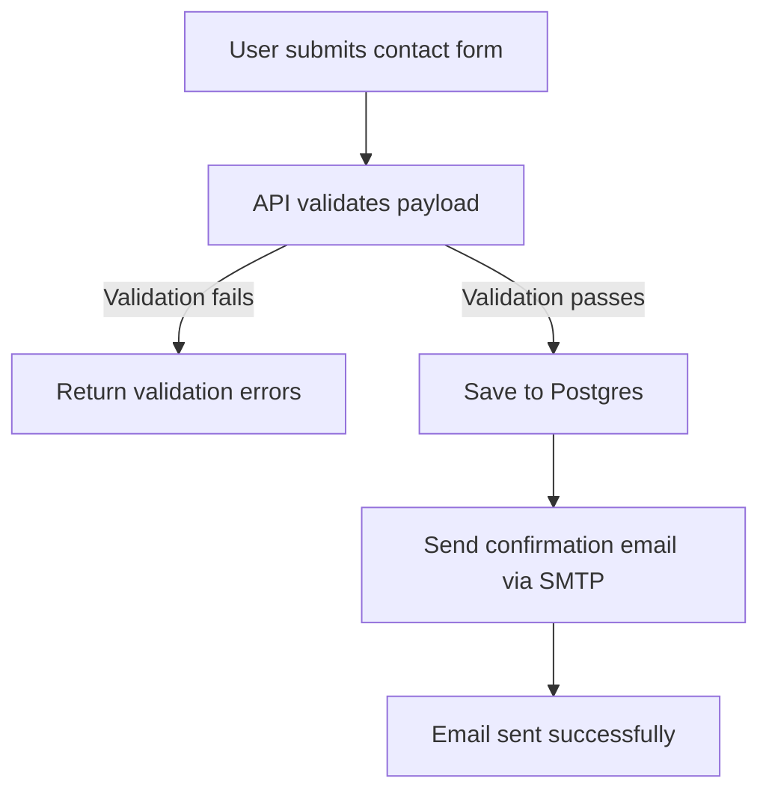
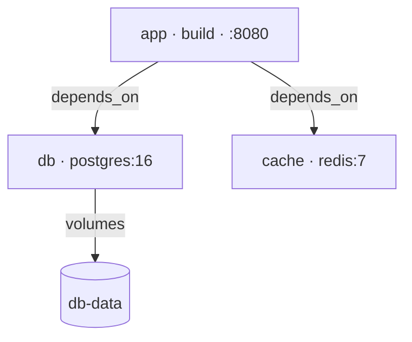

<!-- cspell:ignoreCase ai-test ai-commit ai-diagram qwen ollama zshrc mermaid -->

<TLDR>
This article adds `ai-diagram` to the "Ollama daily use" series: give it a plain-English description of a process, or point it at a file like a `docker-compose.yaml`, and it returns a Mermaid diagram — a fenced code block, ready to paste straight into a Markdown file. It's a deliberate bridge between this series and my doc-as-code articles: `docker-compose-viz` and `docker-python-mermaid` both turn *structured* data into diagrams with real parsers; `ai-diagram` handles the case those can't — a description with no schema at all, or a file you don't want to write a parser for just to sketch one diagram.
</TLDR>

I've written more "turn X into a diagram" articles than I first realized: <Link to="/blog/docker-diagram-as-code">Diagrams as code</Link>, <Link to="/blog/docker-compose-viz">a graph from compose.yaml</Link>, <Link to="/blog/docker-python-mermaid">documentation as code with Python and Mermaid</Link>. Every one of them shares the same shape: a real parser reads a structured input and a library draws the picture. That works great — right up until what I want to diagram is a paragraph I just typed, or a one-off config file that isn't worth writing a parser for.

<!-- truncate -->

## Demo — Plain-English Description

<Terminal source="./files/terminal_diagram_text.txt" typewriter />

No YAML, no schema, just a sentence — and a flowchart that branches on the validation, the one step in that sentence whose outcome decides what happens next, while saving and sending stay plain steps. Pasted into this page, the block renders as:



## Demo — An Existing Config File

<Snippet filename="compose.yaml" source="./files/compose.yaml" defaultOpen={false} />

<Terminal source="./files/terminal_diagram_file.txt" typewriter />

Three services, their dependency edges, and the named volume — read straight out of the compose file's own structure, with each image and published port folded into its service's label:



<AlertBox variant="caution" title="Read the Mermaid before you trust it">
For anything going into actual documentation — an onboarding doc, an architecture decision record — treat this the same way as `docker-compose-viz`'s output: a strong first draft. The model can miss an edge case (a `depends_on: condition: service_healthy`, a less obvious network alias) that a real parser like `docker-python-mermaid`'s wouldn't.
</AlertBox>

## More Sentences to Try

Three more descriptions, each one ready to copy into your own terminal. Every link opens the diagram `ai-diagram` printed for it, in the Mermaid Live Editor.

### Support Ticket Triage

```bash
ai-diagram "When a customer submits a support ticket, check if it is urgent. If it is urgent, assign it directly to a senior agent. If it is not urgent, place it in the standard queue and send an automated confirmation email to the customer."
```

[See the diagram it produces on mermaid.live](https://mermaid.live/edit#base64:eyJjb2RlIjoiZmxvd2NoYXJ0IFREXG4gICAgQVtDdXN0b21lciBzdWJtaXRzIHN1cHBvcnQgdGlja2V0XSAtLT4gQntJcyB0aWNrZXQgdXJnZW50P31cbiAgICBCIC0tIFlFUyAtLT4gQ1tBc3NpZ24gdG8gc2VuaW9yIGFnZW50XVxuICAgIEIgLS0gTk8gLS0-IERbUGxhY2UgaW4gc3RhbmRhcmQgcXVldWVdXG4gICAgRCAtLT4gRVtTZW5kIGF1dG9tYXRlZCBjb25maXJtYXRpb24gZW1haWxdXG4gICAgQyAtLT4gRltFbmRdXG4gICAgRSAtLT4gRltFbmRdIn0)

### Login With a Lockout

```bash
ai-diagram "To log into the system, the user enters their username and password. If the credentials are correct, grant access and display the main dashboard. If the credentials are incorrect, check if the attempt count is less than three. If it is less than three, increment the counter and ask the user to try again. Otherwise, lock the account and send a password reset link to the user's email."
```

[See the diagram it produces on mermaid.live](https://mermaid.live/edit#base64:eyJjb2RlIjoiZmxvd2NoYXJ0IFREXG4gICAgQVtVc2VyIGVudGVycyB1c2VybmFtZSBhbmQgcGFzc3dvcmRdIC0tPiBCe0NyZWRlbnRpYWxzIGNvcnJlY3Q_fVxuICAgIEIgLS0gWWVzIC0tPiBDW0dyYW50IGFjY2Vzc11cbiAgICBDIC0tPiBEW0Rpc3BsYXkgbWFpbiBkYXNoYm9hcmRdXG4gICAgQiAtLSBObyAtLT4gRXtBdHRlbXB0IGNvdW50IDwgMz99XG4gICAgRSAtLSBZZXMgLS0-IEZbSW5jcmVtZW50IGNvdW50ZXJdXG4gICAgRiAtLT4gR1tBc2sgdXNlciB0byB0cnkgYWdhaW5dXG4gICAgRSAtLSBObyAtLT4gSFtMb2NrIGFjY291bnRdXG4gICAgSCAtLT4gSVtTZW5kIHBhc3N3b3JkIHJlc2V0IGxpbmsgdG8gZW1haWxdIn0)

### An E-Commerce Order

```bash
ai-diagram "When receiving an e-commerce order, first verify if the requested item is in stock. If it is out of stock, notify the customer and ask if they want to backorder or cancel. If they cancel, process a full refund. If the item is in stock, check if the payment is processed successfully. If payment fails, prompt the user to update their payment method. If payment succeeds, pack the order, generate a shipping label, ship the item, and send a tracking number to the customer."
```

[See the diagram it produces on mermaid.live](https://mermaid.live/edit#base64:eyJjb2RlIjoiZmxvd2NoYXJ0IFREXG4gICAgQVtSZWNlaXZlIGUtY29tbWVyY2Ugb3JkZXJdIC0tPiBCe0lzIGl0ZW0gaW4gc3RvY2s_fVxuICAgIEIgLS0gTm8gLS0-IENbTm90aWZ5IGN1c3RvbWVyXVxuICAgIEMgLS0-IER7V2FudCB0byBiYWNrb3JkZXIgb3IgY2FuY2VsP31cbiAgICBEIC0tIENhbmNlbCAtLT4gRVtQcm9jZXNzIGZ1bGwgcmVmdW5kXVxuICAgIEQgLS0gQmFja29yZGVyIC0tPiBGW1Byb2NlZWQgd2l0aCBvcmRlcl1cbiAgICBCIC0tIFllcyAtLT4gR3tQYXltZW50IHByb2Nlc3NlZCBzdWNjZXNzZnVsbHk_fVxuICAgIEcgLS0gTm8gLS0-IEhbUHJvbXB0IHVzZXIgdG8gdXBkYXRlIHBheW1lbnQgbWV0aG9kXVxuICAgIEggLS0-IEdcbiAgICBHIC0tIFllcyAtLT4gSVtQYWNrIG9yZGVyXVxuICAgIEkgLS0-IEpbR2VuZXJhdGUgc2hpcHBpbmcgbGFiZWxdXG4gICAgSiAtLT4gS1tTaGlwIGl0ZW1dXG4gICAgSyAtLT4gTFtTZW5kIHRyYWNraW5nIG51bWJlciB0byBjdXN0b21lcl0ifQ)

## Where This Actually Sits Next to `docker-python-mermaid`

<AlertBox variant="info" title="Not a replacement — a different job">
<Link to="/blog/docker-python-mermaid">`docker-python-mermaid`</Link> parses a `compose.yaml` too, and it is the right tool for a diagram that lives in the documentation: a script written once for that input format, deterministic, regenerated on every change. `ai-diagram` is for the other half of the job: a Slack message's worth of description, or a format you have no script for — an `nginx.conf`, a CI workflow, a SQL schema. Less precision, no setup at all — I use both, depending on whether the diagram has to stay in sync or just has to exist by this afternoon.
</AlertBox>

## The `ai-diagram` Function

No need to copy anything yet: the `.zsh` files shown in this article are here to be read, and [Installing It](#installing-it) at the end creates every one of them in `~/.zsh/fns/` for you.

<Snippet filename="~/.zsh/fns/ai-diagram.zsh" source="./files/ai-diagram.zsh" defaultOpen={true} />

Two input modes, told apart by a single test — if the first argument is an existing file, it's a file:

1. **A file** — read as-is, and the prompt asks the model to infer the diagram type from context (a `compose.yaml` implies a service graph, a folder listing implies a tree, an OpenAPI spec implies a sequence diagram). A short list of rules keeps the graph honest: one node per entity, one edge per relationship, attributes such as an image or a port inside the labels, storage drawn as a cylinder.
2. **Free text** — everything after the command is treated as the description, and the model picks whichever Mermaid diagram type fits best on its own, adding a failure branch only where a step is itself a check (a validation, a login, a payment) — never an invented "email sent?" on a plain action.

Either way, the output is a `` ```mermaid `` block and nothing else. The prompt asks for exactly that, and `_ai_strip_fences` then keeps only the fenced lines before the function re-wraps them itself — so even an answer that opens with "Here is your diagram:" comes out ready to paste into a post, where this blog renders it natively.

Before pasting it anywhere, you'll want to see it. The last line, `Preview: https://mermaid.live/edit#base64:…`, opens the diagram in the [Mermaid Live Editor](https://mermaid.live) with a Ctrl+click from the terminal — rendered, and editable if the model got a label wrong. The editor reads its whole state from the part of the URL after the `#`: the JSON `{"code": "…"}`, base64url-encoded, so `jq` and `base64` are all it takes to build. That fragment is never sent to the server in the request; the diagram is decoded and drawn by the page, in your browser. The link goes to stderr, so `ai-diagram compose.yaml > docs/services.md` still writes nothing but the Mermaid block.

## Registered in the `ai` Menu

Two lines — `AI_COMMANDS[diagram]=...` and `AI_PARAMS[diagram]="text"` — make it reachable as `ai diagram <input>` or directly as `ai-diagram`, alongside every other function in the series. Picked from the bare `ai` menu, it prompts for its input: type a description, or a file name.

`_ollama_query`, `_ai_strip_fences` and the `AI_COMMANDS` registry all live in the shared `_ollama.zsh` foundation introduced in <Link to="/blog/ollama-test-generator">ai-test</Link>. If you already followed an earlier article in this series, it's already sitting in `~/.zsh/fns/` and sourced by your autoloader — nothing more to do. Starting here instead? It is one of the files created in [Installing It](#installing-it) below.

## Key Takeaways

<StepsCard
  variant="remember"
  title="ai-diagram quick reference"
  steps={[
    { content: "**Two input modes** — an existing file, or free-text description, auto-detected" },
    { content: "**Diagram type is inferred** — flowchart, sequence, ER, class, state — the model picks based on context" },
    { content: "**Output is fence-only** — a raw ```mermaid block, re-wrapped by the function itself, meant to be pasted directly" },
    { content: "**Ctrl+click to preview** — a mermaid.live link on stderr opens the rendered diagram, stdout stays paste-ready" },
    { content: "**Complements, doesn't replace, `docker-python-mermaid`** — a script for diagrams that must stay in sync; this for everything else" },
    { content: "**Registers into `ai`** — reachable as `ai diagram`" }
  ]}
/>

## Installing It

Everything runs on your machine: zsh, `curl` and `jq` (which builds the request sent to Ollama), and an Ollama server you can reach — see <Link to="/blog/ollama-installation">installing Ollama</Link> if you don't have one yet.

**1. Create the files.** Every function of this series lives in its own file in `~/.zsh/fns/`. The one-liner below creates that folder and the two files in one go — or download the ZIP, or create each file by hand and paste its content. `_ollama.zsh` is the foundation the whole series shares: if an earlier article already gave it to you, the copy here is the same file.

<ProjectSetup folderName="~/.zsh/fns">
  <Snippet filename="_ollama.zsh" source="./files/_ollama.zsh" defaultOpen={false} />
  <Snippet filename="ai-diagram.zsh" source="./files/ai-diagram.zsh" defaultOpen={false} />
</ProjectSetup>

**2. Load the folder from `~/.zshrc`.** Already done if you followed an earlier article of this series. Otherwise, add these lines at the end of `~/.zshrc` — they source every `.zsh` file in the folder, so the next function you add needs no change here:

```zsh title="~/.zshrc"
for fn_file in ~/.zsh/fns/*.zsh; do
  source "$fn_file"
done
```

**3. Open a new terminal** (or run `exec zsh` in the current one), and check that the shell knows the new function:

```zsh
type ai-diagram
```

`ai-diagram is a shell function from …/ai-diagram.zsh` means you're ready. `ai-diagram not found` means step 2 is missing.

## Conclusion

My doc-as-code articles have always assumed I already had something structured to feed a parser. `ai-diagram` is what fills the gap before that point — the sentence I just typed, the file I have but haven't written a parser for. It won't replace <Link to="/blog/docker-diagram-as-code">Diagrams as code</Link> or <Link to="/blog/docker-python-mermaid">docker-python-mermaid</Link> for anything that needs to be exact and reproducible, but for the "let me just sketch this quickly" case that used to mean opening a whiteboard tool, it's turned into one command and a paste.
