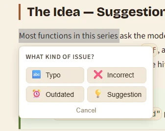
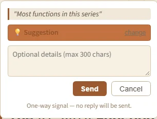
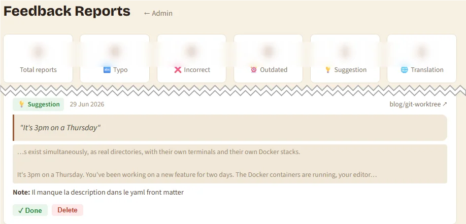

<TLDR>
A reader spots a problem in your article — a typo, a factual error, an outdated command. They have no way to tell you. They move on. You stay unaware. This article builds a complete, one-way feedback widget from scratch: readers select a passage, a popover appears with four issue types (typo, incorrect info, outdated content, suggestion), they optionally add details, and the report lands in a JSON file on your server with an email notification. The PHP API is hardened with HMAC nonces, honeypot, rate limiting, and deduplication. The React component is SSR-safe, uses a clean state machine, and rate-limits submissions in `localStorage`. A companion admin dashboard at `/typo-dashboard` lets you review all reports by type. No database, no third-party service, no npm dependencies beyond what Docusaurus already ships.
</TLDR>

Your blog is your public face. A stray typo, a command that no longer works, an API that changed — these cost you credibility every time someone hits that paragraph. The problem is that most readers will not bother opening a GitHub issue or sending an email. But if you make it trivially easy — one click, right where they are — a surprising number will.

This article builds that mechanism end to end.

<!-- truncate -->

<QuickJump
  links={[
    { label: "See it in action", to: "#see-it-in-action" },
    { label: "Create the component", to: "#create-the-component" },
  ]}
/>

## See it in action

The widget is live on this very page. **Select a few words of this paragraph** with your mouse (or your finger on a phone): a popover appears right below the selection, offering four kinds of feedback.

<BrowserWindow url="https://www.avonture.be/blog/docusaurus-typo-report-component">



</BrowserWindow>

Pick one, and a small form lets the reader add an optional comment before sending. The form says it plainly: **this is a one-way signal** — the reader leaves no email, so nobody waits for a reply.

<BrowserWindow url="https://www.avonture.be/blog/docusaurus-typo-report-component">



</BrowserWindow>

On your side, every report lands in a JSON file on the server, you get an email, and a token-protected page lists everything, newest first, with counters per type:

<BrowserWindow url="https://www.avonture.be/typo-dashboard">



</BrowserWindow>

## How it works

The feature has two independent halves that mirror the pattern used by the [Reaction component](/blog/docusaurus-reactions) (like / dislike votes):

```plaintext
Reader selects text
  └─ mouseup / touchend fires on <article>
       └─ popover shows 4 feedback-type buttons (phase: selecting)
            └─ reader picks a type → optional details form (phase: confirming)
                 └─ POST api/typo.php
                      └─ validates nonce, honeypot, rate limits, dedup
                           └─ writes typo-data.json
                                └─ emails admin (6h cooldown)
```

- **No database** — reports are appended to a JSON file, under a file lock.
- **No third-party service** — a single PHP script sits next to your static files.
- **Defense in depth** — nine independent layers stop bots, floods and duplicates (detailed at the end, for the curious).
- **SSR-safe** — the component renders nothing until the reader selects text.

---

## Part 1 — The PHP API

### Why PHP?

Docusaurus produces a static site. It has no server-side runtime. If you host on shared hosting (OVH, Infomaniak, o2switch…), a small <Link to="/blog/php-api-tips">PHP script</Link> sitting next to your static files is the lowest-friction backend you can have — no Node process to manage, no Docker container, no serverless cold starts.

### File structure on the server

```tree expanded=true showJSX=false debug=false title="File structure"
public_html/
  api/
    .env                    ← secrets (never committed)
    .env.example            ← template committed to git
    .htaccess               ← protects JSON files
    typo.php                ← the API
    typo-data.json          ← reports (writable by web server)
    typo-ratelimit.json     ← counters
    typo-notifications.json ← email throttle
```

### The script

The API answers three requests: `GET` hands out a nonce (and, with `?admin=TOKEN`, the full report list), `POST` stores a report, `OPTIONS` answers the CORS preflight. Each `POST` goes through the nine layers described in the security section at the end of this article before anything is written.

<Snippet filename="api/typo.php" source="./files/typo.php" />

### Protect the JSON files

Without the <Link to="/blog/apache-htaccess">.htaccess rule</Link> shipped in `api/.htaccess`, anyone can `GET https://yourdomain.com/api/typo-data.json` and read every report.

### Secrets

The `api/.env` file holds two secrets. Generate them with:

<Terminal  wrap={true} typewriter>
openssl rand -hex 32   # IP_HASH_SALT
openssl rand -hex 32   # NONCE_SECRET
</Terminal>

---

## Part 2 — The React component

### SSR safety first

Docusaurus renders pages server-side (Node.js) before hydrating them in the browser. Any code that touches `window`, `document`, or `localStorage` will crash the SSR pass if it runs at the module level or inside the component body.

The rules:

1. All DOM access goes inside `useEffect` — it only runs in the browser.
2. State is initialized to `"idle"`, not a value read from the browser.
3. The component returns `null` when idle — no DOM, no SSR mismatch.

### State machine

Six phases, linear with one fork:

```plaintext
idle
  └─ user selects text → selecting
       └─ user picks a feedback type → confirming
            └─ form submitted → submitting
                 ├─ success → done
                 └─ error   → error
```

`done` and `error` show a dismissible badge that resets to `idle`. `selecting` and `confirming` reset to `idle` if the user clicks outside the popover. `confirming` has a "change" link that goes back to `selecting`.

### localStorage helpers

Before the type-selection popover appears, two client-side guards run:

1. **Rate limit** — max 5 submissions per browser per hour. Timestamps are stored as a JSON array in `localStorage` under `"typo_reports"`. Entries older than 24 hours are pruned on every write.

2. **Deduplication** — an FNV-1a hash of `slug + "|" + lowercase(text)` is stored alongside the timestamp. If the same text was already reported from this browser (regardless of type), the component skips straight to `done`.

FNV-1a is used instead of `crypto.subtle.digest` because it is synchronous, and the collision risk is acceptable for this use case.

```js
function fnv1a(str) {
  let hash = 0x811c9dc5;
  for (let i = 0; i < str.length; i++) {
    hash ^= str.charCodeAt(i);
    hash = (hash * 0x01000193) >>> 0;
  }
  return hash.toString(16);
}
```

### Feedback types

Four types cover the vast majority of issues readers might notice:

```js
const FEEDBACK_TYPES = [
  { id: "typo",       icon: "🔤", label: "Typo" },
  { id: "incorrect",  icon: "❌", label: "Incorrect" },
  { id: "outdated",   icon: "⏰", label: "Outdated" },
  { id: "suggestion", icon: "💡", label: "Suggestion" },
];
```

They are displayed in a 2×2 grid. The PHP API validates the `type` field against this same whitelist — any other value gets a 400.

### Capturing context

When the user selects text, the component records ±100 characters of surrounding text from `article.innerText`. This context is sent to the API so you can locate the exact sentence without opening the post:

```js
const fullText = article.innerText || "";
const idx = fullText.indexOf(text);
contextRef.current = idx !== -1
  ? fullText.slice(Math.max(0, idx - 100), idx + text.length + 100)
  : "";
```

### Tooltip positioning

The popover appears just below the selection. `window.scrollY + rect.bottom + 8` puts it 8px below the selected text's bottom edge. To prevent the 280px-wide form from overflowing the right edge of the viewport:

```js
const left = Math.min(window.scrollX + rect.left, window.innerWidth - 296);
```

### The component

<Snippet filename="src/components/TypoReport/index.tsx" source="./files/index.tsx" />

Three things worth noting:

- `touchend` is registered alongside `mouseup` so the widget works on touch devices.
- `handleTypeSelect` runs the rate-limit and dedup checks when the type is chosen, not on selection — this avoids burning a rate-limit slot when the user just selects text to copy.
- The `disclaimer` paragraph ("One-way signal — no reply will be sent") is intentional: making it explicit prevents frustration.

The CSS module uses Docusaurus `--ifm-*` custom properties throughout, so the widget follows your theme and dark mode with no extra work.

---

## Part 3 — Wiring into Docusaurus

This is where Docusaurus swizzling comes in. Rather than modifying the upstream theme file directly, Docusaurus lets you copy any theme component into `src/theme/` and override it. If you have not already swizzled `BlogPostItem`, run:

<Terminal  wrap={true} typewriter>
yarn swizzle @docusaurus/theme-classic BlogPostItem --wrap
</Terminal>

This creates `src/theme/BlogPostItem/index.js`. Open it and add:

<Snippet filename="src/theme/BlogPostItem/index.js" source="./files/BlogPostItem.js" />

The `isBlogPostPage` guard is critical — without it, the component would also mount on the blog list page, where there is no article element.

---

## Part 4 — The admin dashboard

The PHP admin endpoint (`GET ?admin=TOKEN`) returns raw JSON. Rather than reading that raw response, a small React page at `/typo-dashboard` presents it in a readable format: it flattens all per-slug report arrays into a single list sorted newest-first, and shows summary counters by type at the top.

The dashboard is token-gated: it reuses the same `reactions_admin_token` key in `localStorage` as the reactions dashboard, so you only authenticate once across both.

If you have an admin hub page, add this entry to its `TOOLS` array in `src/pages/admin.js`:

<Snippet filename="src/pages/admin.js" source="./files/admin-tool.js" />

---

## Create the component

Create these files in your Docusaurus site, then copy `api/.env.example` to `api/.env` and paste the two secrets generated above:

<ProjectSetup folderName="/your_docusaurus_site" createFolder={false}>
  <Snippet filename="api/typo.php" source="./files/typo.php" defaultOpen={false} />
  <Snippet filename="api/.htaccess" source="./files/.htaccess" defaultOpen={false} />
  <Snippet filename="api/.env.example" source="./files/.env.example" defaultOpen={false} />
  <Snippet filename="src/components/TypoReport/index.tsx" source="./files/index.tsx" defaultOpen={false} />
  <Snippet filename="src/components/TypoReport/styles.module.css" source="./files/styles.module.css" defaultOpen={false} />
  <Snippet filename="src/pages/typo-dashboard.js" source="./files/typo-dashboard.js" defaultOpen={false} />
  <Snippet filename="src/pages/typo-dashboard.module.css" source="./files/typo-dashboard.module.css" defaultOpen={false} />
</ProjectSetup>

Then mount the component in `src/theme/BlogPostItem/index.js` as shown in Part 3.

### Deployment

The API uses `declare(strict_types=1)` and a `never` return type on `jsonError()`, so your server must run **PHP 8.1 or newer**:

<Terminal  wrap={true} typewriter>
php -v
</Terminal>

The three JSON files must be writable by the web server process:

<Terminal  wrap={true} typewriter>
$ chmod 664 api/typo-data.json api/typo-ratelimit.json api/typo-notifications.json
</Terminal>

Once deployed, verify the full round-trip before announcing the feature:

<Snippet filename="smoke-test.sh" source="./files/smoke_curl_command.txt" />

Clean up after testing:

<Snippet filename="cleanup.sh" source="./files/smoke_cleanup.txt" />

---

## Security design — layer by layer (skip this if you just want it running)

Every `POST` crosses nine independent layers before a report is written.

### Layer 1 — CORS

Only `https://www.yourdomain.com` and `http://localhost:3000` (dev) are allowed as `Origin`. Any other origin gets a silent `403`. Same-origin requests carry no `Origin` header and are allowed through.

### Layer 2 — Method whitelist

The API only responds to `GET` (nonce + admin), `POST` (submit), and `OPTIONS` (preflight). Everything else gets `405 Method Not Allowed`.

### Layer 3 — HMAC nonce

Without this, anyone who knows your API URL can submit arbitrary reports with a simple `curl` command. The nonce is a time-keyed HMAC token:

```php
$nonce = hash_hmac('sha256', floor(time() / 900) . '|typo-report', NONCE_SECRET);
```

The token is valid for the current 15-minute window and the previous one (to avoid edge-case expiry when a user fetches the nonce at minute 14 and submits at minute 15). There is no storage — the token is self-validating. Every `POST` must include this value in the body.

### Layer 4 — Input validation, type whitelist, and honeypot

The honeypot is a hidden `<input name="website">` that is invisible to humans but filled in by bots. If `website !== ""`, the API returns `200 OK` without storing anything.

Real input is then validated:

- `slug` — alphanumeric, hyphens, slashes, max 200 chars
- `text` — 3 to 150 chars, printable Unicode only (`\P{C}` — no control characters)
- `type` — must be one of `typo`, `incorrect`, `outdated`, `suggestion` (any other value → 400)
- `comment` — optional, max 300 chars, same character filter
- `context` — optional, max 300 chars, trimmed

### Layer 5 — Global rate limit

A sliding 60-second window with a max of 20 requests across all IPs. This protects against sudden bursts. The window state is stored under a `__global__` key in `typo-ratelimit.json`, updated inside a single `LOCK_EX` block.

### Layer 6 — Per-IP rate limits

Two limits tracked independently:

- Max 10 reports per IP per rolling hour
- Max 3 reports per IP per article per 24 hours

IP addresses are never stored raw. They are hashed with a secret salt: `hash('sha256', IP_HASH_SALT . $ip)`. One-way — you cannot recover the original IP — but consistent enough to aggregate.

The script reads `REMOTE_ADDR`, never `X-Forwarded-For`: on shared hosting, `X-Forwarded-For` can be spoofed by the client, allowing a single IP to impersonate thousands and bypass per-IP limits.

### Layer 7 — Deduplication

An SHA-256 hash of `slug + "|" + lowercase(text)` is stored as `text_hash` on every report. Before writing, existing reports for that slug are scanned. If the hash already exists, the API returns `200 OK` without storing. This silently absorbs duplicate submissions.

### Layer 8 — File-locked writes

PHP on shared hosting is multi-process. Every write uses `fopen` + `flock(LOCK_EX)` + `ftruncate` + `rewind` + `fwrite` + `flock(LOCK_UN)` + `fclose`. The rate-limit check and write happen in the same lock to avoid TOCTOU races.

### Layer 9 — Email throttle

You do not want an inbox flood if a popular article gets 50 reports in one hour. The notification system checks `typo-notifications.json` for the last email timestamp per article. A new email is only sent if more than 6 hours have elapsed since the last one.

---

## Known limitations

### Tooltip overflow on the left edge

The `Math.min(left, window.innerWidth - 296)` clamp prevents the 280px-wide form from going off-screen on the right. A left overflow (selection near the left edge of very narrow viewports) is not clamped.

### Shared hosting NAT

Users behind the same NAT (e.g. office Wi-Fi) share the same `REMOTE_ADDR`. If three different people from the same office report issues on the same article within 24 hours, the fourth will be rate-limited. This is an acceptable trade-off given the shared-hosting constraint.

---

## Conclusion

Readers will never open a GitHub issue to tell you a command is outdated — but they will select a sentence and click a button. With about 250 lines of PHP and 300 lines of React, every one of those signals now reaches your inbox, with the exact sentence and its surrounding context, without a database or a third-party service.

The architecture is deliberately simple: every piece can be understood, debugged, and modified by reading one file. If you want readers to tell you what they *liked* too, the [Reaction component](/blog/docusaurus-reactions) uses exactly the same PHP + JSON pattern.
