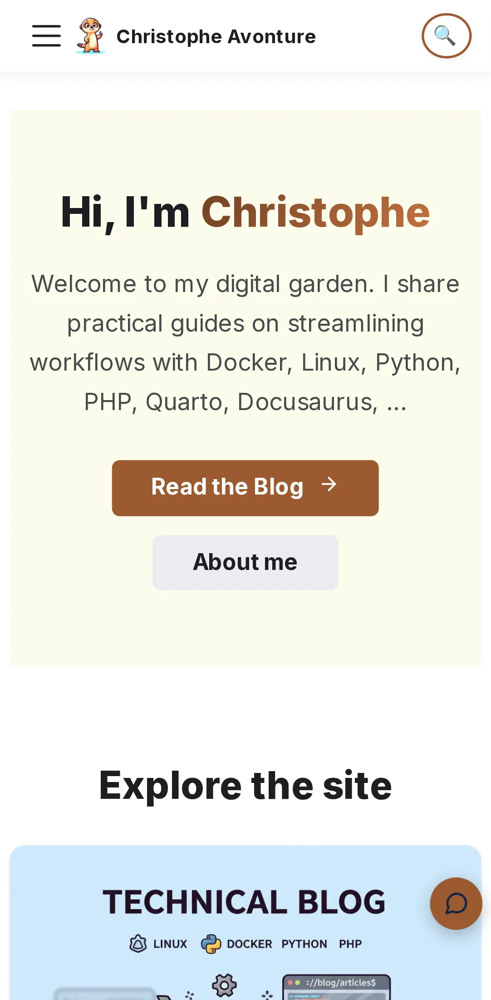

<!-- cspell:ignore ipconfig devcontainer mkcert avonture -->

<TLDR>
Testing a phone-only feature — a shake gesture, a PWA install prompt, anything that needs a real accelerometer or a real home screen — used to feel like it required deploying first, just to see whether it fires. It doesn't: the dev server already started inside this blog's devcontainer (`yarn start --host 0.0.0.0`, HTTPS, port 3000 published by Docker in `compose.yaml`) is reachable from a phone on the same Wi-Fi right now — no plugin, no new dependency, no deploy. Find the computer's LAN IP (`ipconfig` on Windows), visit `https://<that-ip>:3000` from the phone's browser, click through one certificate warning, done. Covers why it works, what to do when the network blocks devices from seeing each other (the phone's own hotspot), and where that certificate warning actually comes from.
</TLDR>

A feature that only makes sense on a phone — a shake gesture like the one behind [this blog's meerkat easter egg](/blog/docusaurus-shake-easter-egg), a haptic buzz, an "Add to Home Screen" prompt — is awkward to validate from a laptop. Simulating it is possible, but it proves the code runs, not that the actual feature works on an actual phone. The instinct is to deploy first and check on the real site, which turns "does this work" into a several-minutes round trip for every tiny adjustment.

It doesn't have to be that way: the dev server already running inside this blog's devcontainer has been reachable from a phone on the same Wi-Fi the whole time.

<!-- truncate -->

## Find Your Computer's IP, Then Just Visit It

The phone needs the address your computer has on your home network. It is different on every network, so the `192.168.0.218` used below is only the author's address; yours will look similar (`192.168.0.x`, `192.168.1.x` or `10.0.0.x` are the usual shapes).

On Windows, open a Command Prompt or PowerShell (on Windows itself, not in a WSL or devcontainer terminal) and run `ipconfig`:

<Terminal title="Windows Command Prompt" source="./files/ipconfig-output.txt" />

Look for the adapter that shows an `IPv4 Address` line: `Wi-Fi` if the computer uses wireless, `Ethernet` if it is plugged in with a cable, as in the example above. Skip adapters marked `Media disconnected`, such as an inactive VPN, and ignore `127.0.0.1` and any `172.x` address reported by WSL or Docker adapters: those only mean something to the computer itself, not to another device on the network.

On macOS, run `ipconfig getifaddr en0` in a terminal. On a computer running Linux natively, run `hostname -I` and take the first address. Don't run `hostname -I` inside WSL2: it returns the address of WSL's internal virtual network (a `172.x` address), which the phone cannot reach. Under Windows, `ipconfig` is the command to use, even when the devcontainer runs through WSL2.

Type your own address in the box below; the URL that follows updates with it:

<Vars ip="192.168.0.218" labels={{ ip: "Your computer's LAN IP" }} />

Then, from the phone — same Wi-Fi network — open that address in a browser, on the same port the dev server already uses:

<BrowserWindow url="https://%%ip=192.168.0.218%%:3000/">
  
</BrowserWindow>

The browser will flag the certificate as untrusted first — expected, and safe to click through here; more on exactly why in [Under the Hood](#under-the-hood-skip-this-if-you-just-want-to-use-it) below. Past that one warning, this is the real dev server: live reload, the actual HTML, and — the reason this was worth figuring out — real sensor and browser APIs that only behave correctly outside a lab simulation.

## Why It Works

- **The dev server already listens on every interface, not just the computer itself.** `docker-entrypoint.sh` starts it as `yarn start --host 0.0.0.0`; without that flag, it would only answer requests originating from inside its own container, invisible to anything else — including the computer's own Wi-Fi adapter.
- **Docker publishes the port on the computer's network.** The devcontainer's `compose.yaml` declares `ports: - "3000:3000"`, and Docker Desktop binds a published port on every network interface of the computer, Wi-Fi included. That is what makes the dev server reachable from the phone. VS Code's own port forwarding (the **Ports** panel) is not involved: it only forwards to `localhost` on the computer.
- **HTTPS is deliberate, not incidental.** A growing list of browser APIs — motion sensors, clipboard access, service workers, camera and microphone — refuse to run outside a secure context. A dev server answering over plain HTTP would hide exactly the behavior a real, deployed HTTPS site will have.
- **Same Wi-Fi is the entire requirement.** Nothing is routed through the internet, no router configuration, no account — the phone and the computer just need to be able to see each other on the local subnet. The one common exception is covered next.

## When Your Phone Can't Reach It

Some networks won't allow this: guest Wi-Fi and a fair number of public or corporate networks enable **client isolation**, which deliberately stops devices on the same network from reaching each other, even though both are connected to the same access point. If the phone times out instead of showing a certificate warning, this is the most likely reason — and no amount of double-checking the IP address will fix it.

The simplest way around it is to create a network where isolation does not apply: turn on the phone's own **mobile hotspot** and connect the computer to it. The phone and the computer are then on the same small network, controlled by the phone. Run `ipconfig` again, because the computer gets a new address on that network, and visit `https://<new-ip>:3000` from the phone as before. Keep an eye on mobile data if the computer starts downloading updates while connected.

## Under the Hood (skip this if you just want to use it)

**Why the certificate warning shows up at all.** The dev server's certificate is not self-signed: `docker-entrypoint.sh` generates it with `mkcert`, signed by a local certificate authority that the computer already trusts. The phone sees two problems with it. First, it has never heard of that local authority, whose root certificate exists only on the computer. Second, the certificate was issued for `localhost` and `127.0.0.1` only, and the phone is asking for your LAN IP (`192.168.0.218` in the example). The connection is still encrypted; what the phone cannot confirm is the server's *identity*, which is acceptable for a computer you already know is yours.

If clicking through that warning on every test session gets old, the `mkcert` approach from [Configure your Docker localhost to use SSL without browser warnings](/blog/docker-localhost-ssl) fixes both problems with two changes. Add the LAN IP to the names the certificate covers (`mkcert ... localhost 127.0.0.1 <your-lan-ip>`), then install the `rootCA.pem` file that `mkcert -CAROOT` points to on the phone as a trusted certificate authority. After that, the phone accepts the certificate like any other, with no warning.

**What if the port is not published?** A devcontainer started from a plain `image` or `Dockerfile`, without a `ports:` entry in a Compose file (or `appPort` in `devcontainer.json`), is only reachable through VS Code's port forwarding, and that forwarding listens on `localhost` only. The phone then cannot reach it. Publishing the port is the fix: add `"3000:3000"` to the service's `ports:` list, or `"appPort": [3000]` to `devcontainer.json`, then rebuild the container. Verified on this blog's own setup ([Windows + WSL2 + Docker Desktop](/blog/vscode-devcontainer)).

## Conclusion

No deploy, no plugin, no new dependency — a dev server already configured for this (`--host 0.0.0.0`, HTTPS, a port published by Docker) turns out to already be reachable from a real phone on the same Wi-Fi, one IP address and one certificate warning away. The certificate warning it costs is a one-time click, not a reason to avoid testing on a real device — a shake gesture, a haptic buzz, or an install prompt only ever really proves itself on one.

<StepsCard
  variant="remember"
  title="The two ways in"
  steps={[
    "**Same Wi-Fi:** `ipconfig` (Windows) for the computer's LAN IPv4 address, then `https://<that-ip>:3000` from the phone — click through the certificate warning once",
    "**Client isolation blocking device-to-device traffic:** turn on the phone's mobile hotspot, connect the computer to it, run `ipconfig` again for the new address",
    "**Recurring annoyance with the certificate warning:** add the LAN IP to the `mkcert` certificate and install mkcert's `rootCA.pem` on the phone — see [Configure your Docker localhost to use SSL without browser warnings](/blog/docker-localhost-ssl)",
  ]}
/>
