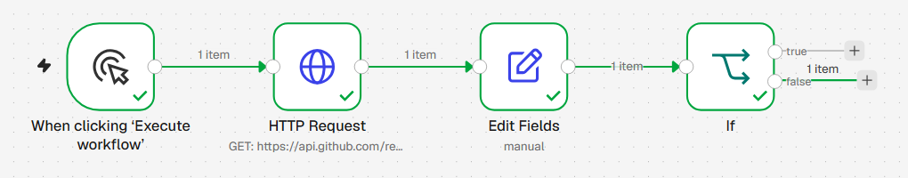
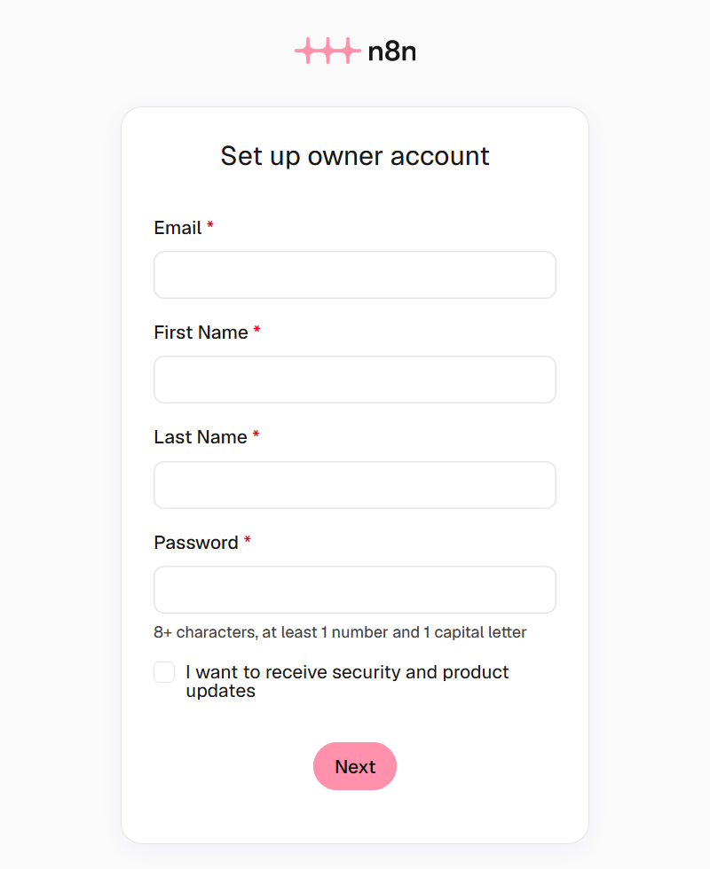
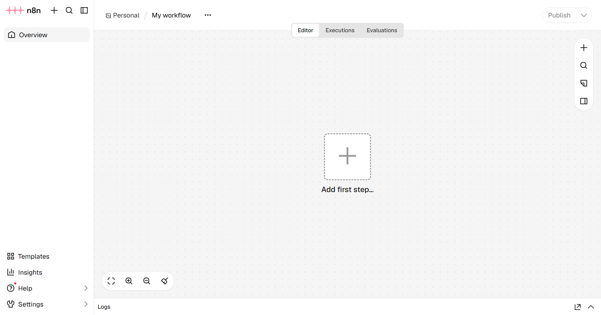
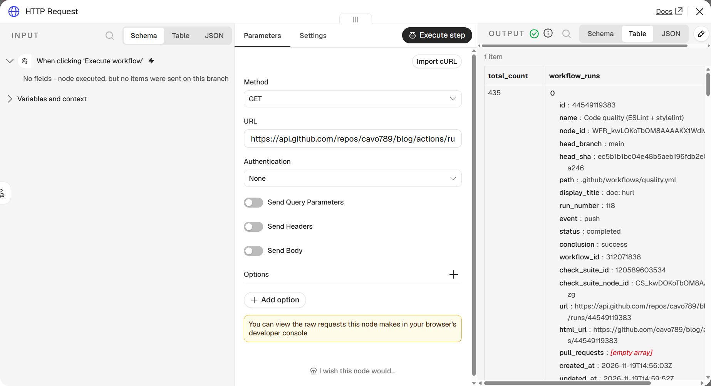
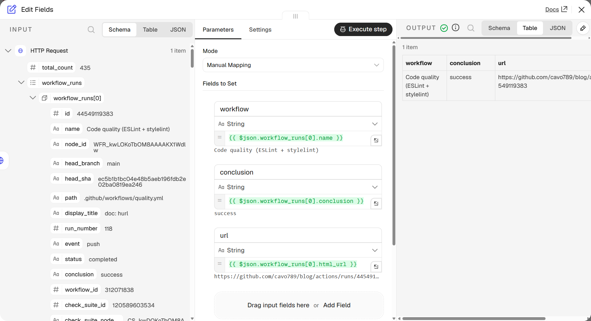
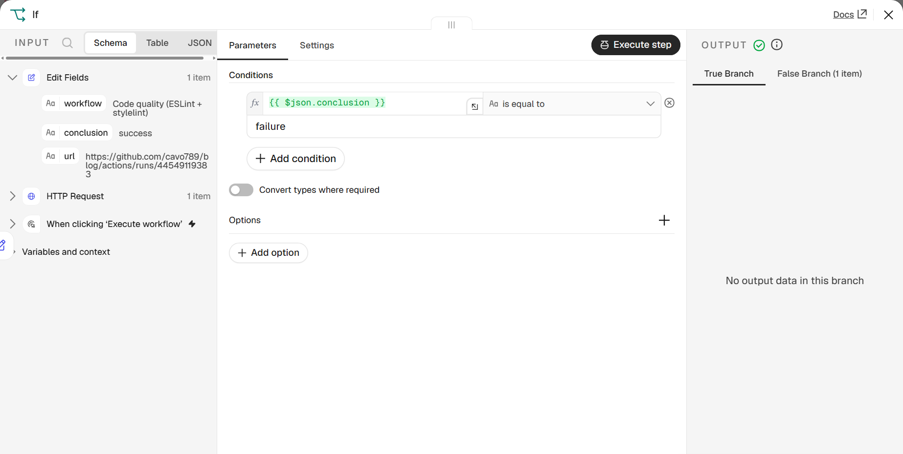
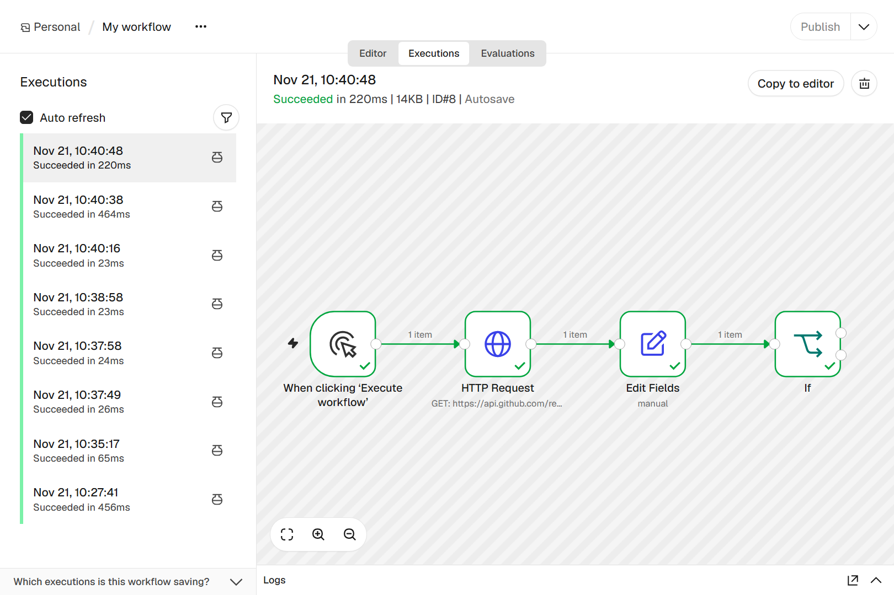
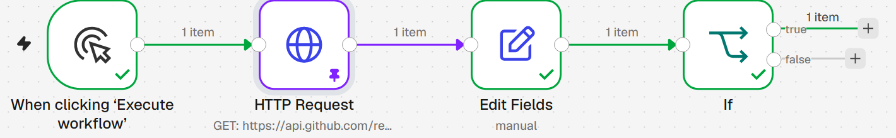
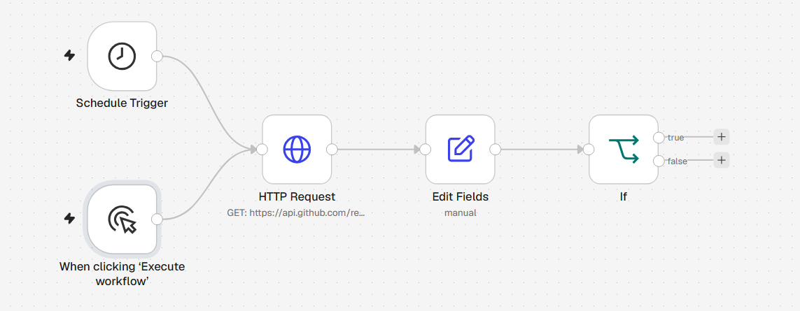

<TLDR>
Scripts and AI commands wait for you to launch them. n8n is a self-hosted automation tool that starts on its own when an event happens: a webhook, a schedule, a new RSS item. It connects web APIs, databases, files and messaging services in a visual editor, mostly without code. This article installs it with Docker and builds a first workflow in that editor: checking the latest CI run of a repository, on a schedule. First article of a series.
</TLDR>

My terminal is full of useful commands. They all share one flaw: they only do something when I think of typing them. Did that pipeline fail an hour ago? Is that disk almost full? Nobody tells me, because nobody's watching. And writing one more little server just to receive a webhook isn't how I want to spend my evening.

By the end of this article, you'll have n8n running on your machine and a workflow, built with your own hands in its editor, that checks your CI while you do something else.

<!-- truncate -->

## What n8n Does for You

This is an n8n workflow. It asks GitHub how the latest CI run of a repository ended, keeps three fields out of a hundred, and sends failures one way and successes the other:

<BrowserWindow url="http://localhost:5678">
  
</BrowserWindow>

There's no code in it. Each box is a **node** picked from a list and set up with a form; the arrows carry the data from one to the next. You'll build this exact workflow later in the article, in about ten minutes.

That's the whole recipe, and it applies far beyond CI. A workflow chains four kinds of steps:

| Step | What it does | A few of the built-in nodes |
| --- | --- | --- |
| **Start** | Decides *when* the workflow runs | On a schedule, a webhook call, a new file in a folder, a new RSS item, a click |
| **Fetch** | Gets data from somewhere | HTTP Request (any web API), Postgres, MySQL, Microsoft SQL, Google Sheets, files on disk, CSV and Excel files, FTP, SSH |
| **Transform and check** | Reshapes and filters | Edit Fields, Filter, If, Sort, Merge, Remove Duplicates, Summarize |
| **Deliver** | Does something with the result | Send an e-mail, post to Slack or Telegram, write a CSV file, insert rows in a database, call another API |

If you've used an ETL tool like <Link to="/blog/pentaho-discovery">Pentaho</Link>, the middle columns look familiar. n8n covers the lighter end of that ground: small, event-driven flows rather than heavy nightly data loads. And when a workflow writes a CSV or JSON file every night, <Link to="/blog/duckdb-json-csv">DuckDB</Link> queries it with SQL the next morning.

Hundreds of services have a ready-made node, and when none fits, the *HTTP Request* node talks to any web API. Low-code, then, and often no-code: a *Code* node accepts JavaScript or Python for the day a form is not enough, but nothing in this article needs it.

## Why Not Just a Script?

- A workflow begins with a **trigger**, so it runs when something happens and not when you remember it.
- Each node shows the data it received and sent, **now and for every past run**. When something breaks at 3 AM, you read what happened instead of adding `echo` lines and running it again.
- It's **self-hosted**: your workflows, your execution data and your credentials stay on your machine.

For one small task, a cron job and a few lines of Bash are often simpler, and I keep them. n8n earns its place once you connect several services, want to see each execution, and would rather not maintain the plumbing.

## Install n8n

n8n runs as a Docker container with a named volume, which keeps your workflows and your account across restarts. Give it a permanent home, `~/tools/n8n/`:

<ProjectSetup folderName="~/tools/n8n">
  <Snippet filename="compose.yaml" source="./files/compose.yaml" defaultOpen={true} />
  <Snippet filename="start.sh" source="./files/start.sh" defaultOpen={true} />
</ProjectSetup>

Then start it:

<Terminal source="./files/start.txt" wrap={true} typewriter />

<AlertBox variant="info" title="Restart policy">
Because of `restart: unless-stopped`, Docker brings it back on its own after a reboot.
</AlertBox>

Open [http://localhost:5678](http://localhost:5678). On first launch, n8n asks you to create a local owner account. Nothing leaves your machine: any e-mail address and a password with 8+ characters, a digit and a capital letter will do.

<BrowserWindow url="http://localhost:5678">
  
</BrowserWindow>

## Build Your First Workflow in the Editor

The question: *is the latest CI run of my repository green?* Four nodes answer it, and you'll write one line of code at most. I use this blog's repository, `cavo789/blog`; put any public repository of yours in its place.

### 1. Create the workflow and its trigger

On the welcome screen, click **Build a workflow**. You get an empty canvas, with the **Editor** and **Executions** tabs at the top and the **Publish** button on the right:

<BrowserWindow url="http://localhost:5678">
  
</BrowserWindow>

Give it a name first: click *My workflow* at the top left, type `Latest CI` and press <kbd>Enter</kbd>. That name is what you'll find in the workflow list, and in the terminal later on.

Click **Add first step…**. A panel asks *What triggers this workflow?*: pick **Trigger manually**. A node named *When clicking ‘Execute workflow’* appears: the workflow will run each time you click **Execute** at the bottom of the canvas. Perfect while you're building.

### 2. Fetch the latest run

Click the **+** on the right of the trigger. The panel lists groups of nodes: open **Core** (*Run code, make HTTP requests, set webhooks…*) and pick **HTTP Request**. Keep the **GET** method and fill in a single field:

- **URL**: `https://api.github.com/repos/cavo789/blog/actions/runs?per_page=1`

Click **Execute step**. The panel splits in three: what comes **in** on the left, the settings in the middle, what comes **out** on the right. The output is the real answer of GitHub, which you can read as a schema, a table or raw JSON:

<BrowserWindow url="http://localhost:5678">
  
</BrowserWindow>

This is the moment n8n differs from a script: you don't print variables to guess what the API returned, you look at it.

### 3. Keep only what matters

The answer holds about a hundred fields; three are enough. Close the HTTP Request panel with the **×** at its top right: you're back on the canvas, where the two nodes are now linked.

Click the **+** on the right of the HTTP Request node, open the **Data transformation** group (*Manipulate, filter or convert data*) and pick **Edit Fields (Set)**. On its left, the input panel shows the answer of the previous step. In the middle, the **Fields to Set** box says *Drag input fields here or Add Field*: click the **Add Field** link three times, to get three empty fields.

For each one, type the name in the **name** box, then **drag** the matching field from the input panel (`workflow_runs` › `workflow_runs[0]`) into the **value** box:

| Name         | Field to drag | Expression it writes                      |
| ------------ | ------------- | ----------------------------------------- |
| `workflow`   | `name`        | `{{ $json.workflow_runs[0].name }}`       |
| `conclusion` | `conclusion`  | `{{ $json.workflow_runs[0].conclusion }}` |
| `url`        | `html_url`    | `{{ $json.workflow_runs[0].html_url }}`   |

Dragging writes the expression for you, and n8n shows its current value right below it. Click **Execute step**: the output panel shows three fields, nothing else.

<BrowserWindow url="http://localhost:5678">
  
</BrowserWindow>

### 4. Split success and failure

Close the panel again. Click the **+** on the right of Edit Fields, open the **Flow** group (*Branch, merge or loop the flow…*) and pick **If**. One condition: drag `conclusion` from the input panel into the first box, keep **is equal to**, and type `failure` in the second. Click **Execute step**: the output panel now has two tabs, **True Branch** and **False Branch**. The latest run is green, so it lands in **False Branch (1 item)**:

<BrowserWindow url="http://localhost:5678">
  
</BrowserWindow>

Close the panel and click **Execute** at the bottom of the canvas: the whole chain runs again, each node turns green, and a small counter on the arrows tells how many items went where. You now have the workflow shown at the top of this article.

The **true** branch leads nowhere yet. That's where an alert will go, in the next article of this series.

### 5. Two things worth knowing in the editor

- **Executions.** The tab at the top of the editor lists every run. Click one and you see the workflow exactly as it was then: open any node to read the data it received and sent. When something fails at 3 AM, that's where you look.

  <BrowserWindow url="http://localhost:5678">
    
  </BrowserWindow>

- **Pin and edit.** You don't need a red run to test the red path. Open the HTTP Request node after a run, click the pencil icon at the top of the output panel, replace `"conclusion": "success"` with `"conclusion": "failure"` and save. Editing the output pins it: a purple banner says *This data is pinned for test executions*, and the next runs reuse it instead of calling GitHub. Click **Execute**: this time the item leaves through **true**, the opposite of step 4, because the data now says `failure`. Click **Unpin** in that banner once you're done.

  <BrowserWindow url="http://localhost:5678">
    
  </BrowserWindow>

  n8n still says *Workflow executed successfully*, and it's right: the **workflow** worked. The failed **pipeline** is only data flowing through it. Turning that data into a message is the job of the next node on the **true** branch, which is the subject of the next article.

## Run It on a Schedule

The manual trigger only fires when you click. To check GitHub every hour without you, add a second trigger *next to* the first one, not after it:

1. Click the **+** at the top right of the canvas (not the **+** on the right of a node: that one inserts the new node *into* the chain, after the manual trigger). Search for *Schedule*, pick **Schedule Trigger** and set it to every hour. It lands on the canvas on its own, linked to nothing.
2. Drag from its output dot (the small circle on its right) to the input dot of **HTTP Request** (the circle on its left).
3. Click **Publish**.

A node can receive more than one arrow: whichever trigger fires, the same chain runs. Clicking keeps working for your tests, and the schedule runs it every hour. From now on the **Executions** tab fills up on its own, one line per hour.

<BrowserWindow url="http://localhost:5678">
  
</BrowserWindow>

Lost along the way? Import the finished workflow and compare: create a new workflow (the **+** at the top left), open the **…** menu next to its name, then **Import from File**.

<Snippet filename="latest-ci.json" source="./files/latest-ci.json" defaultOpen={false} />

## Run It from the Terminal

The editor is where you build a workflow; you don't need it to run one. n8n ships a command-line interface inside its container, so a workflow can run from a terminal, a cron job or a deploy script.

### 1. Find the workflow ID

Each workflow has an ID. List them:

<Terminal source="./files/list-workflow.txt" wrap={true} typewriter />

Yours is a different string of letters and digits. Paste it here and every command below uses it:

<Vars workflowId="yqIwJNvGEziTd6jW" labels={{ workflowId: "Workflow ID" }} />

### 2. Run it

`n8n execute` runs the workflow and prints the full execution as JSON, a few log lines included. This small script keeps only what one node produced, the *Edit Fields* one by default. Add it next to `compose.yaml` (it needs `jq` on your machine):

<ProjectSetup folderName="~/tools/n8n">
  <Snippet filename="run.sh" source="./files/run.sh" defaultOpen={true} />
</ProjectSetup>

<Terminal source="./files/cli-run-workflow.txt" wrap={true} typewriter />

It's plain JSON, so the rest of your toolbox takes over: <Code>./run.sh <Var name="workflowId">yqIwJNvGEziTd6jW</Var> | jq -r .conclusion</Code> prints `success`, ready for an `if` in a shell script. Each run also shows up in the Executions tab, like the ones started from the editor.

### 3. Export it as a file

A workflow is a JSON document. Export it to keep it next to your code, in Git:

<Terminal>
{`$ docker compose exec -T n8n n8n export:workflow --id=%%workflowId=yqIwJNvGEziTd6jW%% --pretty > latest-ci.json`}
</Terminal>

The file holds the nodes, their settings and the links between them. `n8n import:workflow` loads it back on another machine, and the editor's **Import from File** reads it too.

## Where to Go Next

This article is the first of a series. The *Latest CI* workflow is the backbone of the next ones; each adds one piece:

1. **Get the alert on your phone.** Plug the **true** branch into ntfy, Telegram or e-mail, and you're told only when a run fails.
2. **Receive GitHub and GitLab events directly.** A *Webhook* trigger instead of the schedule: the CI calls n8n the moment a run ends, instead of n8n asking every hour.
3. **Add a local LLM.** n8n has Ollama nodes: summarize a feed every morning, sort incoming mails, explain a failed log. It's the next step after my <Link to="/series/ollama-daily-use">"Ollama daily use"</Link> series.
4. **Watch your machine.** A schedule, a disk or container check, an alert when something is off. If all you need is uptime, <Link to="/blog/docker_uptime_kuma">Uptime Kuma</Link> does it out of the box.
5. **Deploy workflows from Git.** The export above, versioned, then imported automatically on another n8n instance.

<AlertBox variant="warning" title="A webhook is a public door">
Receiving events from GitHub or GitLab means making n8n reachable from the internet. Put it behind HTTPS, set the `WEBHOOK_URL` variable, and protect each webhook with the authentication option of the node. Your n8n instance stores credentials for your services, so it deserves the same care as any other sensitive server.
</AlertBox>

## Conclusion

At the beginning of this article, my automations waited for me to type them. With n8n, an event is enough: a schedule fires or a webhook arrives, the workflow runs, and every step stays readable afterwards. Build the *Latest CI* workflow in the editor, and let it run on a schedule for a day: opening the Executions tab the next morning and seeing it worked while you were doing something else is what makes it click.
