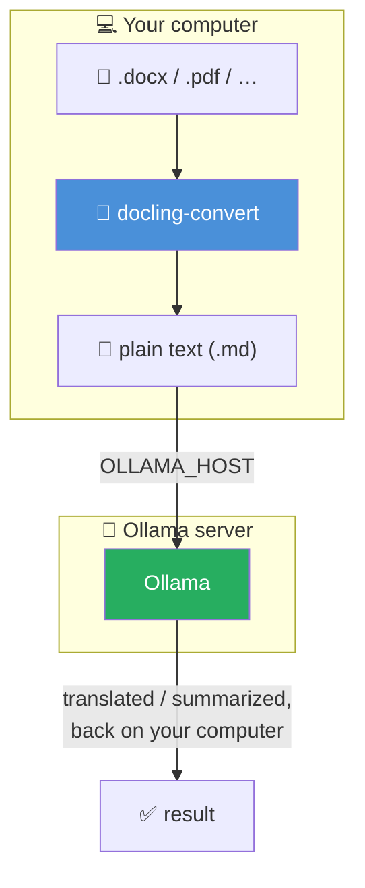

<!-- cspell:ignoreCase ai-test ai-commit ai-translate ai-summarize qwen ollama docling zshrc -->

<TLDR>
Cet article ajoute `ai-translate` et `ai-summarize` à la série « Ollama daily use ». Les deux acceptent un fichier `.pdf`, `.docx`, `.pptx`, `.xlsx` ou `.html` — extrait en Markdown par [Docling](/blog/docling) — ou directement un simple fichier `.md`/`.txt`, puis passent le texte au modèle Ollama local pour le traduire ou le condenser en points clés. Tout l'aller-retour reste sur votre machine : pas d'API de traduction cloud, aucun upload de document nulle part. C'est précisément l'intérêt pour un contrat, un document RH, ou tout ce que vous hésiteriez à coller dans Google Translate.
</TLDR>

Je travaille dans un bureau où un `.docx` atterrit dans ma boîte mail en néerlandais, en anglais ou en français. Pour de très bonnes raisons, j'ai parfois besoin de traduire d'une langue vers une autre.

Quand ce n'est pas confidentiel du tout, le réflexe de tout le monde est d'ouvrir le navigateur, de coller dans un outil de traduction, et d'espérer que personne ne s'offusque qu'un contrat client vienne de transiter par les serveurs d'un tiers. Personne ne m'a jamais explicitement dit de ne pas le faire. C'est exactement le genre de chose pour laquelle vous ne devriez pas avoir besoin d'une permission.

<!-- truncate -->

## Démo — ai-translate {#demo--ai-translate}

Traduction d'un contrat depuis n'importe quelle langue vers le français :

<Terminal source="./files/terminal_translate_french.txt" typewriter />

Et le même vers le néerlandais :

<Terminal source="./files/terminal_translate_dutch.txt" typewriter />

C'est un contrat de prestation fictif, converti depuis `.docx` et traduit en français/néerlandais, avec chaque titre et chaque terme en gras intact — le genre de document que je ne collerais vraiment pas dans un traducteur en ligne.

Même document, pour que vous puissiez l'essayer vous-même avant d'adapter l'une ou l'autre fonction à vos propres fichiers :

<DownloadButton file={require("./files/contract.docx").default} label="contract.docx — le document source" title="Télécharger le contrat de prestation fictif utilisé dans cette démo" />

## Démo — ai-summarize {#demo--ai-summarize}

Le même contrat, condensé en quatre points clés plutôt que traduit :

<Terminal source="./files/terminal_summarize.txt" typewriter />

Les délais de livraison, les conditions de paiement, la clause de résiliation et les parties du contrat-cadre qui sont remplacées — les quatre points qui comptent, sortis sans lire le document complet.

## Réutiliser Docling pour l'extraction {#reusing-docling-for-extraction}

Les deux fonctions ci-dessous partagent une tâche avant même de parler à Ollama : transformer un document en texte brut. J'ai déjà construit cette brique dans [mon article sur Docling](/blog/docling) — `docling-convert file.docx` produit `file.md` en local, avec accélération GPU si vous l'avez configuré ainsi. Plutôt que de dupliquer cette logique deux fois, elle vit dans un petit helper :

Pas besoin de copier quoi que ce soit pour l'instant : les fichiers `.zsh` montrés dans cet article sont là pour être lus, et [L'installer](#installing-it) à la fin les crée tous dans `~/.zsh/fns/` pour vous.

<Snippet filename="~/.zsh/fns/_ai-docs.zsh" source="./files/_ai-docs.zsh" defaultOpen={true} />

<AlertBox variant="note" title="Les fichiers Markdown et texte sautent la conversion">
Si vous avez déjà un fichier `.md` ou `.txt`, `_ai_extract_text` fait juste un `cat` dessus — pas d'appel à Docling, pas de dépendance. L'étape de conversion ne se déclenche que pour les vrais formats bureautiques.
</AlertBox>

<AlertBox variant="caution" title="Pourquoi le subshell autour de docling-convert">
`docling-convert` (de l'article précédent) monte le *répertoire courant* dans son container et attend un nom de fichier relatif à celui-ci — il n'a pas été conçu pour résoudre un chemin absolu arbitraire. `( cd "$dir" && docling-convert "$filename" )` l'exécute depuis le dossier du document, dans un subshell, de sorte que votre répertoire de travail réel reste intact au retour de la fonction.
</AlertBox>

## ai-translate {#ai-translate}

<Snippet filename="~/.zsh/fns/ai-translate.zsh" source="./files/ai-translate.zsh" defaultOpen={true} />

On extrait, puis on demande au modèle de traduire vers la langue passée en second argument (le français par défaut — celle dont j'ai le plus souvent besoin), avec une instruction explicite de préserver la structure Markdown pour que les titres, listes et tableaux survivent à l'aller-retour au lieu de s'écrouler en un pavé de texte.

## ai-summarize {#ai-summarize}

<Snippet filename="~/.zsh/fns/ai-summarize.zsh" source="./files/ai-summarize.zsh" defaultOpen={true} />

Même étape d'extraction, prompt différent : un nombre fixe de points clés (5 par défaut), avec la consigne explicite de privilégier les décisions, les chiffres, les échéances et les actions à mener plutôt qu'une description générique — et de répondre dans la langue du document source, plutôt que de basculer silencieusement en anglais.

## Enregistrées dans le menu ai {#registered-in-the-ai-menu}

Deux lignes — `AI_COMMANDS[translate]=...` et `AI_COMMANDS[summarize]=...` — et les deux sont accessibles via `ai translate` / `ai summarize`, ou directement via `ai-translate` / `ai-summarize`, aux côtés de toutes les autres fonctions de cette série.

Les deux fonctions appellent `_ollama_query` et s'enregistrent dans `AI_COMMANDS`, qui vivent dans la base partagée `_ollama.zsh` introduite dans <Link to="/blog/ollama-test-generator">ai-test</Link>. Si vous avez déjà suivi un article précédent de cette série, elle est déjà dans `~/.zsh/fns/` et sourcée par votre autoloader — rien de plus à faire. Vous commencez ici ? C'est l'un des fichiers créés dans [L'installer](#installing-it) ci-dessous.

<AlertBox variant="tip" title="Docling et Ollama ne doivent pas être sur la même machine">

`docling-convert` tourne toujours en local, sans GPU requis — convertir un document en Markdown fonctionne sur n'importe quel portable. Traduire ou résumer nécessite par contre un serveur Ollama joignable quelque part : les deux fonctions se connectent à `OLLAMA_HOST`, même configuration que dans <Link to="/blog/accessing-ollama-across-your-local-network">accéder à Ollama depuis votre réseau local</Link> — un LAN partagé, ou un VPN/tunnel entre deux réseaux distincts.



</AlertBox>

## À retenir {#key-takeaways}

<StepsCard
  variant="remember"
  title="ai-translate / ai-summarize en bref"
  steps={[
    { content: "**Extraction partagée** — `_ai_extract_text` dans `_ai-docs.zsh`, réutilisée par les deux fonctions" },
    { content: "**Docling pour les formats bureautiques** — `.pdf`/`.docx`/`.pptx`/`.xlsx`/`.html` passent d'abord par `docling-convert`" },
    { content: "**Markdown/texte sautent la conversion** — les fichiers `.md`/`.txt` sont lus directement" },
    { content: "**Rien ne quitte la machine** — extraction et traduction/résumé tournent en local, de bout en bout" },
    { content: "**S'enregistrent dans `ai`** — accessibles via `ai translate` et `ai summarize`" }
  ]}
/>

## L'installer {#installing-it}

Tout tourne sur votre machine : zsh, `curl` et `jq` (qui construit la requête envoyée à Ollama), et un serveur Ollama que vous pouvez joindre — voyez <Link to="/blog/ollama-installation">installing Ollama</Link> si vous n'en avez pas encore. Pour les fichiers `.pdf`, `.docx`, `.pptx`, `.xlsx` et `.html`, il vous faut aussi `docling-convert`, issu de <Link to="/blog/docling">mon article sur Docling</Link>.

**1. Créez les fichiers.** Chaque fonction de cette série vit dans son propre fichier dans `~/.zsh/fns/`. La commande ci-dessous crée ce dossier et les quatre fichiers d'un coup — ou téléchargez le ZIP, ou créez chaque fichier à la main et collez son contenu. `_ollama.zsh` est la base que toute la série partage : si un article précédent vous l'a déjà donnée, la copie ici est le même fichier.

<ProjectSetup folderName="~/.zsh/fns">
  <Snippet filename="_ollama.zsh" source="./files/_ollama.zsh" defaultOpen={false} />
  <Snippet filename="_ai-docs.zsh" source="./files/_ai-docs.zsh" defaultOpen={false} />
  <Snippet filename="ai-translate.zsh" source="./files/ai-translate.zsh" defaultOpen={false} />
  <Snippet filename="ai-summarize.zsh" source="./files/ai-summarize.zsh" defaultOpen={false} />
</ProjectSetup>

**2. Chargez le dossier depuis `~/.zshrc`.** Déjà fait si vous avez suivi un article précédent de cette série. Sinon, ajoutez ces lignes à la fin de `~/.zshrc` — elles sourcent chaque fichier `.zsh` du dossier, donc la prochaine fonction que vous ajoutez ne demandera aucune modification ici :

```zsh title="~/.zshrc"
for fn_file in ~/.zsh/fns/*.zsh; do
  source "$fn_file"
done
```

**3. Ouvrez un nouveau terminal** (ou lancez `exec zsh` dans celui en cours), et vérifiez que le shell connaît les nouvelles fonctions :

```zsh
type ai-translate ai-summarize
```

`ai-translate is a shell function from …/ai-translate.zsh` signifie que vous êtes prêt. `ai-translate not found` signifie que l'étape 2 manque.

## Conclusion {#conclusion}

La vraie histoire de confidentialité ici n'est ni une politique ni une promesse — c'est une architecture. Un document entre, Docling le transforme en texte sans appel réseau, Ollama traite ce texte sans appel réseau, et le résultat atterrit dans mon terminal. Il n'y a aucune étape de cette chaîne où « faire confiance au fournisseur » est nécessaire, et c'est exactement ce qui la rend utilisable pour les documents que je n'aurais jamais risqués sur un outil cloud. Entre ça, `ai-ci` pour les pipelines, `ai-standup` pour le récap du matin et le reste de cette série, le modèle local que j'avais déjà en route pour d'autres raisons trouve sans cesse une chose de plus à faire, discrètement, en arrière-plan, sans rien me demander d'autre qu'un chemin de fichier.
