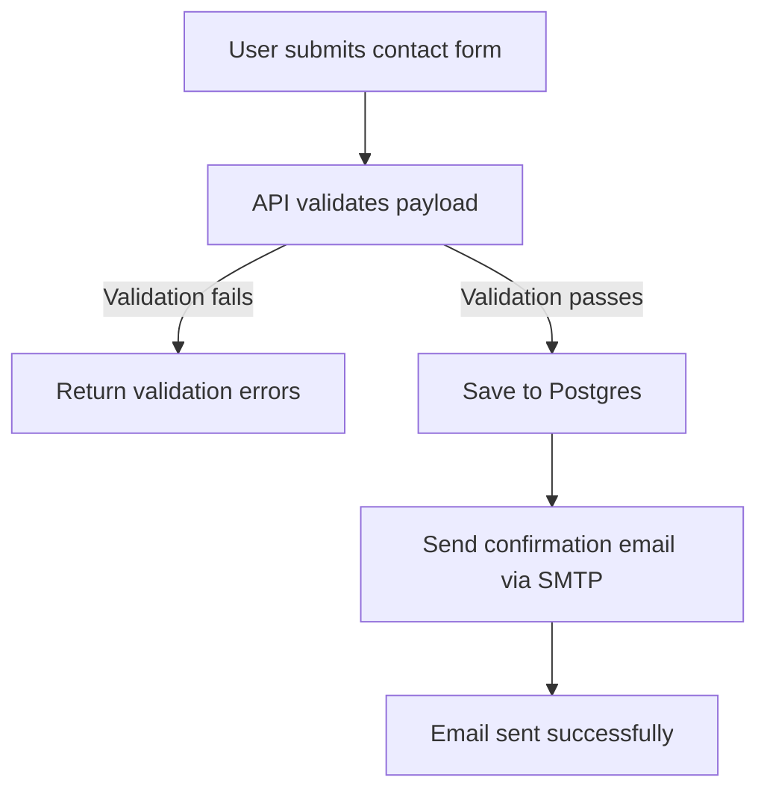
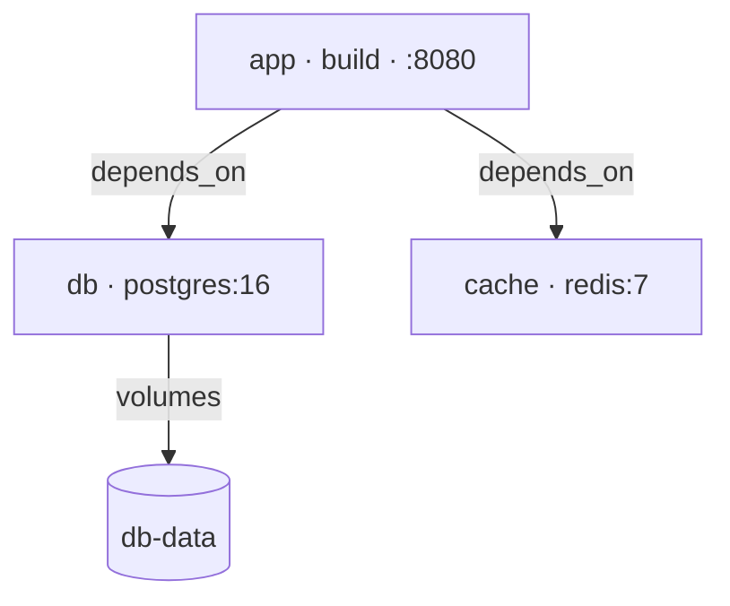

<!-- cspell:ignoreCase ai-test ai-commit ai-diagram qwen ollama zshrc mermaid -->

<TLDR>
Cet article ajoute `ai-diagram` à la série « Ollama daily use » : donnez-lui la description d'un processus en langage naturel, ou pointez-le vers un fichier comme un `docker-compose.yaml`, et il renvoie un diagramme Mermaid — un bloc de code, prêt à coller directement dans un fichier Markdown. C'est un pont volontaire entre cette série et mes articles doc-as-code : `docker-compose-viz` et `docker-python-mermaid` transforment tous deux des données *structurées* en diagrammes avec de vrais parsers ; `ai-diagram` couvre le cas qu'ils ne savent pas traiter — une description sans le moindre schéma, ou un fichier pour lequel vous n'avez pas envie d'écrire un parser juste pour esquisser un diagramme.
</TLDR>

J'ai écrit plus d'articles « transformer X en diagramme » que je ne le croyais : <Link to="/blog/docker-diagram-as-code">Diagrams as code</Link>, <Link to="/blog/docker-compose-viz">un graphe à partir de compose.yaml</Link>, <Link to="/blog/docker-python-mermaid">la documentation as code avec Python et Mermaid</Link>. Tous partagent la même forme : un vrai parser lit une entrée structurée et une librairie dessine l'image. Ça fonctionne très bien — jusqu'au moment où ce que je veux représenter est un paragraphe que je viens de taper, ou un fichier de config ponctuel qui ne mérite pas qu'on lui écrive un parser.

<!-- truncate -->

## Démo — une description en langage naturel {#demo--plain-english-description}

<Terminal source="./files/terminal_diagram_text.txt" typewriter />

Pas de YAML, pas de schéma, juste une phrase — et un flowchart qui se ramifie sur la validation, la seule étape de cette phrase dont l'issue décide de la suite, tandis que l'enregistrement et l'envoi restent de simples étapes. Collé dans cette page, le bloc s'affiche ainsi :



## Démo — un fichier de config existant {#demo--an-existing-config-file}

<Snippet filename="compose.yaml" source="./files/compose.yaml" defaultOpen={false} />

<Terminal source="./files/terminal_diagram_file.txt" typewriter />

Trois services, leurs liens de dépendance et le volume nommé — lus directement dans la structure du fichier compose, avec chaque image et chaque port publié intégrés au label de son service :



<AlertBox variant="caution" title="Relisez le Mermaid avant de lui faire confiance">
Pour tout ce qui part dans de la vraie documentation — un document d'onboarding, un architecture decision record — traitez ça comme la sortie de `docker-compose-viz` : un bon premier jet. Le modèle peut rater un cas limite (un `depends_on: condition: service_healthy`, un alias réseau moins évident) qu'un vrai parser comme celui de `docker-python-mermaid` n'aurait pas manqué.
</AlertBox>

## D'autres phrases à essayer {#more-sentences-to-try}

Trois descriptions de plus, chacune prête à copier dans votre propre terminal. Chaque lien ouvre le diagramme produit par `ai-diagram`, dans le Mermaid Live Editor.

### Tri des tickets de support {#support-ticket-triage}

```bash
ai-diagram "When a customer submits a support ticket, check if it is urgent. If it is urgent, assign it directly to a senior agent. If it is not urgent, place it in the standard queue and send an automated confirmation email to the customer."
```

[Voir le diagramme obtenu sur mermaid.live](https://mermaid.live/edit#base64:eyJjb2RlIjoiZmxvd2NoYXJ0IFREXG4gICAgQVtDdXN0b21lciBzdWJtaXRzIHN1cHBvcnQgdGlja2V0XSAtLT4gQntJcyB0aWNrZXQgdXJnZW50P31cbiAgICBCIC0tIFlFUyAtLT4gQ1tBc3NpZ24gdG8gc2VuaW9yIGFnZW50XVxuICAgIEIgLS0gTk8gLS0-IERbUGxhY2UgaW4gc3RhbmRhcmQgcXVldWVdXG4gICAgRCAtLT4gRVtTZW5kIGF1dG9tYXRlZCBjb25maXJtYXRpb24gZW1haWxdXG4gICAgQyAtLT4gRltFbmRdXG4gICAgRSAtLT4gRltFbmRdIn0)

### Connexion avec verrouillage de compte {#login-with-a-lockout}

```bash
ai-diagram "To log into the system, the user enters their username and password. If the credentials are correct, grant access and display the main dashboard. If the credentials are incorrect, check if the attempt count is less than three. If it is less than three, increment the counter and ask the user to try again. Otherwise, lock the account and send a password reset link to the user's email."
```

[Voir le diagramme obtenu sur mermaid.live](https://mermaid.live/edit#base64:eyJjb2RlIjoiZmxvd2NoYXJ0IFREXG4gICAgQVtVc2VyIGVudGVycyB1c2VybmFtZSBhbmQgcGFzc3dvcmRdIC0tPiBCe0NyZWRlbnRpYWxzIGNvcnJlY3Q_fVxuICAgIEIgLS0gWWVzIC0tPiBDW0dyYW50IGFjY2Vzc11cbiAgICBDIC0tPiBEW0Rpc3BsYXkgbWFpbiBkYXNoYm9hcmRdXG4gICAgQiAtLSBObyAtLT4gRXtBdHRlbXB0IGNvdW50IDwgMz99XG4gICAgRSAtLSBZZXMgLS0-IEZbSW5jcmVtZW50IGNvdW50ZXJdXG4gICAgRiAtLT4gR1tBc2sgdXNlciB0byB0cnkgYWdhaW5dXG4gICAgRSAtLSBObyAtLT4gSFtMb2NrIGFjY291bnRdXG4gICAgSCAtLT4gSVtTZW5kIHBhc3N3b3JkIHJlc2V0IGxpbmsgdG8gZW1haWxdIn0)

### Une commande e-commerce {#an-e-commerce-order}

```bash
ai-diagram "When receiving an e-commerce order, first verify if the requested item is in stock. If it is out of stock, notify the customer and ask if they want to backorder or cancel. If they cancel, process a full refund. If the item is in stock, check if the payment is processed successfully. If payment fails, prompt the user to update their payment method. If payment succeeds, pack the order, generate a shipping label, ship the item, and send a tracking number to the customer."
```

[Voir le diagramme obtenu sur mermaid.live](https://mermaid.live/edit#base64:eyJjb2RlIjoiZmxvd2NoYXJ0IFREXG4gICAgQVtSZWNlaXZlIGUtY29tbWVyY2Ugb3JkZXJdIC0tPiBCe0lzIGl0ZW0gaW4gc3RvY2s_fVxuICAgIEIgLS0gTm8gLS0-IENbTm90aWZ5IGN1c3RvbWVyXVxuICAgIEMgLS0-IER7V2FudCB0byBiYWNrb3JkZXIgb3IgY2FuY2VsP31cbiAgICBEIC0tIENhbmNlbCAtLT4gRVtQcm9jZXNzIGZ1bGwgcmVmdW5kXVxuICAgIEQgLS0gQmFja29yZGVyIC0tPiBGW1Byb2NlZWQgd2l0aCBvcmRlcl1cbiAgICBCIC0tIFllcyAtLT4gR3tQYXltZW50IHByb2Nlc3NlZCBzdWNjZXNzZnVsbHk_fVxuICAgIEcgLS0gTm8gLS0-IEhbUHJvbXB0IHVzZXIgdG8gdXBkYXRlIHBheW1lbnQgbWV0aG9kXVxuICAgIEggLS0-IEdcbiAgICBHIC0tIFllcyAtLT4gSVtQYWNrIG9yZGVyXVxuICAgIEkgLS0-IEpbR2VuZXJhdGUgc2hpcHBpbmcgbGFiZWxdXG4gICAgSiAtLT4gS1tTaGlwIGl0ZW1dXG4gICAgSyAtLT4gTFtTZW5kIHRyYWNraW5nIG51bWJlciB0byBjdXN0b21lcl0ifQ)

## Sa place réelle à côté de `docker-python-mermaid` {#where-this-actually-sits-next-to-docker-python-mermaid}

<AlertBox variant="info" title="Pas un remplaçant — un autre métier">
<Link to="/blog/docker-python-mermaid">`docker-python-mermaid`</Link> parse lui aussi un `compose.yaml`, et c'est le bon outil pour un diagramme qui vit dans la documentation : un script écrit une fois pour ce format d'entrée, déterministe, régénéré à chaque changement. `ai-diagram` sert à l'autre moitié du travail : une description de la taille d'un message Slack, ou un format pour lequel vous n'avez aucun script — un `nginx.conf`, un workflow CI, un schéma SQL. Moins de précision, aucune installation — j'utilise les deux, selon que le diagramme doit rester synchronisé ou simplement exister cet après-midi.
</AlertBox>

## La fonction `ai-diagram` {#the-ai-diagram-function}

Pas besoin de copier quoi que ce soit pour l'instant : les fichiers `.zsh` montrés dans cet article sont là pour être lus, et [L'installer](#installing-it) à la fin les crée tous dans `~/.zsh/fns/` pour vous.

<Snippet filename="~/.zsh/fns/ai-diagram.zsh" source="./files/ai-diagram.zsh" defaultOpen={true} />

Deux modes d'entrée, distingués par un seul test — si le premier argument est un fichier existant, c'est un fichier :

1. **Un fichier** — lu tel quel, et le prompt demande au modèle de déduire le type de diagramme du contexte (un `compose.yaml` implique un graphe de services, un listing de dossier implique un arbre, une spec OpenAPI implique un diagramme de séquence). Une courte liste de règles garde le graphe honnête : un nœud par entité, une arête par relation, les attributs comme une image ou un port dans les labels, le stockage dessiné comme un cylindre.
2. **Du texte libre** — tout ce qui suit la commande est traité comme la description, et le modèle choisit lui-même le type de diagramme Mermaid le plus adapté, en ajoutant une branche d'échec uniquement là où une étape est elle-même une vérification (une validation, une connexion, un paiement) — jamais un « email envoyé ? » inventé sur une action simple.

Dans les deux cas, la sortie est un bloc `` ```mermaid `` et rien d'autre. Le prompt demande exactement ça, et `_ai_strip_fences` ne conserve ensuite que les lignes du bloc avant que la fonction ne les réencadre elle-même — de sorte que même une réponse qui commence par « Here is your diagram: » ressort prête à coller dans un article, où ce blog la rend nativement.

Avant de la coller quelque part, vous voudrez la voir. La dernière ligne, `Preview: https://mermaid.live/edit#base64:…`, ouvre le diagramme dans le [Mermaid Live Editor](https://mermaid.live) avec un Ctrl+clic depuis le terminal — rendu, et modifiable si le modèle s'est trompé sur un label. L'éditeur lit tout son état dans la partie de l'URL après le `#` : le JSON `{"code": "…"}`, encodé en base64url, donc `jq` et `base64` suffisent à le construire. Ce fragment n'est jamais envoyé au serveur dans la requête ; le diagramme est décodé et dessiné par la page, dans votre navigateur. Le lien part sur stderr, donc `ai-diagram compose.yaml > docs/services.md` n'écrit toujours rien d'autre que le bloc Mermaid.

## Enregistrée dans le menu `ai` {#registered-in-the-ai-menu}

Deux lignes — `AI_COMMANDS[diagram]=...` et `AI_PARAMS[diagram]="text"` — la rendent accessible via `ai diagram <input>` ou directement via `ai-diagram`, aux côtés de toutes les autres fonctions de la série. Choisie depuis le menu `ai` seul, elle demande son entrée : tapez une description, ou un nom de fichier.

`_ollama_query`, `_ai_strip_fences` et le registre `AI_COMMANDS` vivent tous dans la fondation partagée `_ollama.zsh` présentée dans <Link to="/blog/ollama-test-generator">ai-test</Link>. Si vous avez déjà suivi un article précédent de cette série, elle se trouve déjà dans `~/.zsh/fns/` et est sourcée par votre autoloader — rien de plus à faire. Vous commencez ici ? C'est l'un des fichiers créés dans [L'installer](#installing-it) plus bas.

## À retenir {#key-takeaways}

<StepsCard
  variant="remember"
  title="ai-diagram en bref"
  steps={[
    { content: "**Deux modes d'entrée** — un fichier existant, ou une description en texte libre, détectés automatiquement" },
    { content: "**Le type de diagramme est déduit** — flowchart, séquence, ER, classe, état — le modèle choisit selon le contexte" },
    { content: "**La sortie n'est qu'un bloc** — un bloc ```mermaid brut, réencadré par la fonction elle-même, destiné à être collé directement" },
    { content: "**Ctrl+clic pour prévisualiser** — un lien mermaid.live sur stderr ouvre le diagramme rendu, stdout reste prêt à coller" },
    { content: "**Complète, ne remplace pas, `docker-python-mermaid`** — un script pour les diagrammes qui doivent rester synchronisés ; ceci pour tout le reste" },
    { content: "**S'enregistre dans `ai`** — accessible via `ai diagram`" }
  ]}
/>

## L'installer {#installing-it}

Tout tourne sur votre machine : zsh, `curl` et `jq` (qui construit la requête envoyée à Ollama), et un serveur Ollama accessible — voyez <Link to="/blog/ollama-installation">installing Ollama</Link> si vous n'en avez pas encore.

**1. Créez les fichiers.** Chaque fonction de cette série vit dans son propre fichier dans `~/.zsh/fns/`. La ligne de commande ci-dessous crée ce dossier et les deux fichiers d'un coup — sinon téléchargez le ZIP, ou créez chaque fichier à la main et collez son contenu. `_ollama.zsh` est la fondation partagée par toute la série : si un article précédent vous l'a déjà donnée, la copie ici est le même fichier.

<ProjectSetup folderName="~/.zsh/fns">
  <Snippet filename="_ollama.zsh" source="./files/_ollama.zsh" defaultOpen={false} />
  <Snippet filename="ai-diagram.zsh" source="./files/ai-diagram.zsh" defaultOpen={false} />
</ProjectSetup>

**2. Chargez le dossier depuis `~/.zshrc`.** Déjà fait si vous avez suivi un article précédent de cette série. Sinon, ajoutez ces lignes à la fin de `~/.zshrc` — elles sourcent chaque fichier `.zsh` du dossier, donc la prochaine fonction que vous ajouterez ne nécessitera aucun changement ici :

```zsh title="~/.zshrc"
for fn_file in ~/.zsh/fns/*.zsh; do
  source "$fn_file"
done
```

**3. Ouvrez un nouveau terminal** (ou lancez `exec zsh` dans celui en cours), et vérifiez que le shell connaît la nouvelle fonction :

```zsh
type ai-diagram
```

`ai-diagram is a shell function from …/ai-diagram.zsh` signifie que vous êtes prêt. `ai-diagram not found` signifie que l'étape 2 manque.

## Conclusion {#conclusion}

Mes articles doc-as-code ont toujours supposé que j'avais déjà quelque chose de structuré à donner à un parser. `ai-diagram` comble le vide en amont — la phrase que je viens de taper, le fichier que j'ai mais pour lequel je n'ai pas écrit de parser. Il ne remplacera pas <Link to="/blog/docker-diagram-as-code">Diagrams as code</Link> ni <Link to="/blog/docker-python-mermaid">docker-python-mermaid</Link> pour ce qui doit être exact et reproductible, mais pour le cas « laisse-moi juste esquisser ça vite fait » qui signifiait avant d'ouvrir un outil de whiteboard, c'est devenu une commande et un collage.
